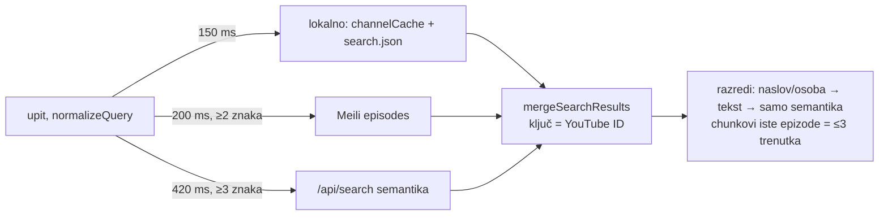

# Pretraga naslovnice: Mali GPU, mobilni ekran i pametni search (13. 10. 2026.)

LIVE: v2.0.183 (razmak + mobilni ekran), v2.0.184 (pametni search).
Commitovi: `a7e567a`, `bcc07f7`, `d2b1d86`.

Vezani dokumenti: `docs/search-and-mobile-header-worklog.md`,
`docs/web-delivery-and-rendering.md`, `docs/plans/virtualni-kanali.md` (odluka O6).

## 1. „Nakon fra ne mogu upisati drugu riječ" — kvar crtanja, ne unosa

Prijava s Androida. Reproducirano na farmi, **moto g86** (MediaTek MT6878,
**Mali-G615 MC2**, Chrome, Gboard), produkcija v2.0.182, skwasm.

| Mjerenje | Rezultat |
|---|---|
| `document.activeElement.value` (CDP) | `"fra stje"` — unos ispravan |
| Što Flutter crta u paleti | „frastje" (razmak negativne širine), „d" kao „đ" („epizođe", „Mlađ za Domovinu") |
| Isti uređaj, `/search` (bez transforma) | ispravno |
| edge 30 ultra (Adreno), ista paleta | ispravno |
| Desktop Chrome / Playwright s iOS UA, 4× CPU throttle | ispravno — emulacija kvar NE vidi |

Uzrok: paleta se otvarala `ScaleTransition` (0,96 → 1,0) i ostajala pod tim
transformom; skwasm na Mali GPU-u pod njim krivo crta glifove. Popravak: samo
`FadeTransition` (pri opacity 1 nema sloja). Test `test/search_overlay_test.dart`
drži da polje nikad nije pod scale transformom.

**Pravilo:** tekst (osobito polje za unos) ne ostavljati pod scale
tranzicijom/transformom; dijalozi se otvaraju fadeom.

**Kako se to dijagnosticira** (bez ovoga se kvar ne vidi):

1. `adb forward tcp:9333 localabstract:chrome_devtools_remote` →
   `playwright.connectOverCDP('http://localhost:9333')` → usporedi
   `activeElement.value` sa screenshotom (`adb exec-out screencap`).
2. Lokalni build na uređaju: `adb reverse tcp:<port> tcp:<port>` + statički
   server s `COOP: same-origin` i `COEP: credentialless`. `localhost` je secure
   context, pa ostaje skwasm (isti renderer kao produkcija); LAN IP bi pao na
   canvaskit i test ne bi vrijedio.
3. Tipkati tapovima po Gboardu (`adb shell input tap`), ne `input text` —
   `input text` zaobilazi IME i zna pojesti prvo slovo.

## 2. Mobilni ekran pretrage

- `shortestSide < 600` (mobitel i u landscapeu) → pretraga preko cijelog
  ekrana s `viewInsets` paddingom; strelica natrag zatvara, × briše upit.
  Centrirana paleta s `maxHeight 0.8 × ekran` nije znala za tipkovnicu: u
  landscapeu je bila potpuno prekrivena.
- Tipka „traži" na tipkovnici mobitela samo spušta tipkovnicu (i keydown
  Enter, koji Gboard na webu šalje, ignorira se na mobitelu); Enter na
  desktopu otvara odabrani red.
- Dok je tipkovnica gore, podnožje (ID / „Prikaži sve") je skriveno — u
  landscapeu je zauzimalo jedini preostali redak.

**Brzina lokalnog sloja.** Korpus: 3326 epizoda, 2,7 MB (`search.json`).
Prije se sve foldalo u svakom `build()`: ~75 ms po buildu (M-čip, JIT), a
build se okidao na spinner, dolazak rezultata i svaku notifikaciju
`channelCache`-a. Sada indeks jednom ~24 ms, upit ~4 ms. `foldText` ima ASCII
brzi put (bez `split('')`).

## 3. Pametni search — tri izvora, jedan rezultat

Povod: `pNSblshqEuU` („Nedjeljom u 2: Damir Sabol") i `UUKPkDRfPMo` („Jo
Nesbø") su ad-hoc obrade (kanal `_unlisted`); `generate_channel_index.js`
preskače `_`-direktorije, pa ih nema u listinzima ni `search.json`. Meili
`episodes` ih ima (derivat ClickHousea, bez filtra po kanalu).

Kod: `lib/services/unified_search.dart` (čista funkcija, testovi u
`test/unified_search_test.dart`), UI u `lib/screens/home/search_overlay.dart`.

Odluke i zamke:

- **Djelomični Meili pogoci.** Meili po defaultu (`matchingStrategy: last`)
  odbacuje riječi s kraja dok ne nađe pogotke, pa „damir sabol" vrati svakog
  „Damira". Meili pogodak je „po naslovu" samo kad `<em>` u naslovu pokriva
  SVE riječi upita (`coversAllTokens`); inače ide u razred teksta.
- **Nema isječka članka.** `article_text` nije u `displayedAttributes` indeksa,
  pa `_formatted.article_text` nikad ne stiže (provjereno curl-om) — i `/search`
  zbog toga nema isječak. Isječak je zato iz `_formatted.section_titles`.
  Producer nismo dirali.
- **`_unlisted` / `_*`** se ne prikazuju kao kanal; red ima samo datum.
- Lokalni rang: naslov +6, govornik +3 (inače epizoda u kojoj je osoba samo
  govornik pobjeđuje onu s imenom u naslovu).
- Odabir (↑/↓) prati ID epizode dok mreža preslaže listu; odgovor za zastarjeli
  upit se baca.
- `/search` ostaje puni prikaz (filtar po kanalu); u paleti vodi „Prikaži sve
  rezultate".
- **`MeiliClient.baseUrl`** je bez `--dart-define=MEILI_URL` gađao `localhost`
  — nightly (iOS/Android) i `flutter run` imali su mrtav full-text. Sad default
  `AppBrand.config.endpoints.meili`.
- `/api/search` odbija `localhost` origin (CORS) — semantiku i trenutke
  provjeravati tek na produkciji.

Provjereno na produkciji v2.0.184: „damir sabol" → Sabol 1. s trenucima
6:28 / 12:19 / 52:48; „Jo Nesbø" 1.; „fra stjepan" i „kako odgajati djecu"
(praćeni kanali) ispravno.

## 4. Usput: „Nanovoroeni"

Nije font. Na hladnom `/search` indeks kanala nije bio učitan, pa je chip
nastajao iz sluga (`nanovoroeni`). Ekran sad pričeka `channelCache.loadIndex()`.

## 5. Kvaliteta rezultata — evaluacija i fuzija rangova (14. 10. 2026.)

Pustili smo 24 upita kroz sva tri izvora na produkciji i spajanje kroz pravi
`mergeSearchResults` (Python snimi odgovore u fixture, Dart test nad njima
izvrti staru i novu verziju koda). Imena, naslovi i jednorječne teme radili
su dobro. **Pitanja nisu**: za „što je rekao papa o ratu u ukrajini"
semantika je na 1. mjestu imala „Papa Franjo i patrijarh Kiril o ratu u
Ukrajini" (0,686), a u spojenoj listi nije bio ni u prvih deset.

Uzroci:

- Razred „tekst" je stajao iznad razreda „semantika", a Meili s
  `matchingStrategy: last` za pitanje od šest riječi vraća 1000 dokumenata
  (pogođenih na „je", „o", „što"). Dvanaest takvih je guralo semantiku dolje.
- Meili dokument je cijeli sažetak epizode, pa se uobičajene riječi u njemu
  uvijek nađu zajedno; ni `all` sam to ne spašava.
- `coversAllTokens` je istaknuto „o" brojao kao pokriće za „ovisnost"
  (prefiks duljine 1), a „megugorje" nije priznavao kao „Međugorje".

Promjene (klijent, bez reindeksiranja):

- Ispod razreda „naslov" redoslijed je **fuzija rangova** (RRF, k = 10):
  svaki izvor doprinosi `w / (k + rang)`, semantika s `w = 2` kad upit ima
  ≥ 3 sadržajne riječi. Epizoda koju nađu dva izvora skuplja oba doprinosa.
- `contentQuery` miče funkcijske riječi; Meili dobiva upit bez njih uz
  `matchingStrategy: 'all'` (samo paleta; `/search` je nepromijenjen).
- Lokalni sloj: „dj" nalazi „đ" („medjugorje").
- `coversAllTokens`: istaknuta riječ mora imati barem 4 znaka zajedničkog
  prefiksa, ili biti unutar Meilijevih pragova tipfelera (1 od 5, 2 od 9).
- Zastarjeli semantički zahtjev se prekida (`AbortableRequest`).

Ishod na istim fixturama: pitanja („papa…", „tuga nakon smrti djeteta",
„zašto mladi napuštaju crkvu", „život nakon smrti") sada imaju relevantne
epizode na mjestima 1–6; imena i naslovi su nepromijenjeni.

Odbačeno: **prag na semantički score**. Dobri pogoci za imena i mjesta
(Bleiburg 0,46–0,49, Vukovar 0,46–0,48) imaju niži score od šuma za
„cuspajz" (0,44–0,47), pa nijedan apsolutni ni relativni prag ne razdvaja.

Latencija `/api/search`: 0,7–2 s pojedinačno, 7–12 s uz tri paralelna upita
(embedder je usko grlo). Meili 70–300 ms. Cloudflare pred oba servisa vraća
403 na `Python-urllib` User-Agent — skripte šalju browserski UA.

Sljedeće, u `domovina-rag` (nije napravljeno): Meili dokument po **sekciji**
uz `distinct: youtube_id`; `speakers`/`topics`/ime kanala kao pretraživa
polja; hrvatski `stopWords` u indeksu; dugoročno Meili hybrid s bge-m3
vektorima umjesto ručnog spajanja tri izvora.

## Otvoreno

- [ ] Pametni search i mobilni ekran nisu isprobani na pravim **iPhoneima**
  farme (samo emulacija; stara verzija je u emulaciji bila ispravna).
- [ ] Native (iOS/Android) build s novim `MeiliClient` defaultom — prvi
  nightly nakon v2.0.184; provjeriti da full-text radi u aplikaciji.
- [ ] Isječak iz članka u Meiliju traži `article_text` u `displayedAttributes`
  (domovina-rag `sync-meili.sh`) — odluka, ne napravljeno.
- [ ] Ostale scale animacije s tekstom na Mali uređaju nisu provjerene
  (`streak_flags.dart` ScaleTransition, pinka `Transform.scale`) — kratke,
  završavaju, ali vrijedi pogledati na moto g86.
