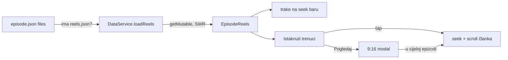

# Istaknuti trenuci (reels) u playeru — 26.10.2026.

LIVE od v2.0.197 (`8493395`, `1ee7d71`). Producent je `fetch.domovina.tv`
(kandidati + 9:16 render), ugovor u
`fetch.domovina.tv/docs/2026-10-25-reels-kandidati.md`.

## Što korisnik vidi

- **Trake na seek baru** za SVE kandidate (odluka korisnika): renderirani
  isječak = puna bijela traka (`onSurface`), kandidat bez videa = tanja,
  prigušena. Crtaju se iznad tracka i preko crta poglavlja; sponzori su ispod.
- **„Istaknuti trenuci"** u panelu playera (`VideoPanel`) i u `_PlayerTab`
  (`/m/`, audio-only): redak po trenutku, poredano po vremenu. Tap = skok u
  epizodu; renderirani ima poster i „Pogledaj". Redak koji svira je istaknut.
- **Vertikalni player** (`showReelViewer`, fade, ne scale): epizoda se
  pauzira; „Pogledaj u cijeloj epizodi" skoči na trenutak, X vrati epizodu u
  prijašnje stanje (svirala → svira dalje). „Kopiraj poveznicu" =
  `episodeShareUrl(id, seconds: start)` (jezik u putanji).
- Na detaljnom ekranu tap na trenutak skrola i **članak** na sekciju u koju
  pada početak trenutka (`_sectionAt`, isto pravilo kao oznake sponzora).

Kod: `lib/models/episode_reels.dart`, `lib/widgets/episode_reels.dart`,
`DataService.loadReels`, testovi `test/episode_reels_test.dart`.

## Odluke i zašto

| Odluka | Razlog |
|---|---|
| `reels.json` samo kad ga `episode.json` navodi; bez bundlea nema reelova | datoteka postoji za ~11 epizoda; bez vrata bi svaka druga platila 404 + retry s cache-busterom |
| `reels.json` je **promjenjiv** (CDN `max-age=60, must-revalidate` + ETag od 26.10.), klijent ga čita kroz `CdnJsonCache.getMutable`, ne `_get` | pipeline ga prepisuje (poster backfill, novi renderi). S `immutable` (kako je bio) preglednik bi staru verziju držao godinu dana. Promijenjeno PRIJE nego ga je ijedan klijent dohvatio |
| poster = `render.poster_url` (540×960 WebP, ~18 kB), nikad `storyboard_url` | storyboard je kontaktni list od 6 kadrova (1128×1024); rezanje u klijentu ovisi o rasporedu |
| bez 720p varijante | odluka korisnika: sve ostaje 1080p (H.264 High@L4.0, ~4,3 Mbps, ~35 MB / 66 s) |
| traka i poglavlja u istom scrollu | 8 redaka je ~450 px; iznad scrolla su pojeli visinu panela |
| popis poglavlja u panelu playera samo kad epizoda NEMA reelova (`_showChapterList`) | uz reelove je treća kopija istih poglavlja (lijevi sidebar + sekcije članka) i njegov auto-scroll odvlačio je panel s trenutka koji je korisnik upravo tapnuo. v2.0.197 ga je ugasio svugdje (`_kShowChapterList = false`) — reelove ima desetak epizoda, pa je panel za ostatak kataloga ostao prazan ispod kontrola |
| bez novih analitičkih događaja | inače bi trebalo mijenjati pravne dokumente (CLAUDE.md, Vlastita analitika) |

## Zamke

- **Slider uvlači track** za `max(overlay, thumb)` radijus s obje strane
  (`BaseSliderTrackShape.getPreferredRect`, Flutter 3.47, kad `padding` nije
  zadan). Markeri preko cijele širine odstupali su do 14 px — u dvosatnoj
  epizodi ~5 min. Sad se crta u uvučenom rasponu (`_kSeekOverlayRadius` u
  panelu, 16 u `_PlayerTab`); popravak vrijedi i za poglavlja i sponzore.
- `primary` za trake se utopio u track i crte poglavlja (ista svijetloplava u
  tamnoj temi); crvena i zlatna su zauzete za sponzore → `onSurface`.
- Kratak trenutak (66 s u satu) je ~6 px; najmanja širina trake je 6 px.
- Tekst je na canvasu: chrome-devtools `wait_for` ga ne nalazi; klik ide
  sintetičkim `PointerEvent` na `flutter-view`, stanje provjeri preko
  `<video>` elemenata (`paused`, `currentTime`, `currentSrc`).
- Storyboard je pokazivao „4.569 €" umjesto 5.000 € (snimljen usred animacije
  brojača); video je bio ispravan. Popravljeno u pipelineu.

## Ugovor na koji se klijent oslanja

`reels.json` u `episode.json.files`; zapis treba `start_sec < end_sec` i
`title` (inače se preskače); video samo uz https `render.url`;
`render.poster_url` opcionalan. Renderirani zapisi su od `select_reels.js`
popravka (fetch `b6fc6d00`) zaključani pri ponovnom izboru; kandidati bez
rendera smiju se promijeniti, vremena su uvijek apsolutna u epizodi.

## Otvoreno

- **Native neprovjereno**: iOS (libmpv), Android, Android TV (EON A11,
  Philips A8) — drugi `Player` u modalu, pauza/nastavak glavnog, poster.
- TV ekran epizode nema reelove; oznake „trenutak iz ove sekcije" u članku.
- Posebna share ruta `/v/<id>/reel/<rank>` (worker OG + AASA + Android
  filter) nije napravljena; dijeli se `/t/<sec>`.
- U lijevom sidebaru je viđena narančasta oznaka na 17:50 nakon skokova —
  vjerojatno postojeće `scrollTimestamp` stanje, nije istraženo.

## Dijeljenje reela (v2.0.201)

Gumb **Podijeli** u 9:16 playeru otvara `showReelShareSheet`
(`lib/widgets/reel_share_sheet.dart`). Korisnik je tražio OBA formata:

| Redak | Što | Veličina |
|---|---|---|
| Pošalji vertikalni video (9:16) | `render.url` kao DATOTEKA kroz `shareFile` (WhatsApp…), uz tekst `episodeShareUrl(id, seconds: start)` | 30–35 MB (1080p) |
| Kopiraj vezu na video | izravni `render.url` | — |
| Preuzmi vodoravni isječak (16:9) | cutter `rangeDownloadUrl(start, ceil(end))`, isto kao poglavlja | ~27 kB/s → ~2 MB/min |
| Kopiraj vezu na vodoravni isječak (16:9) | cutter `rangeInlineUrl` | — |

Odluke i zamke:

- **Preuzimanje kreće na otvaranje lista**, a „Pošalji" se omogući tek kad su
  bajtovi tu — `navigator.share` mora pasti u svježu gestu (isti razlog kao
  e-knjiga). Pamti se samo zadnji reel (35 MB u memoriji).
- CDN za `data/<id>/reels/*.mp4` šalje `access-control-allow-origin: *`
  (izmjereno 26.10. na `DOfcONrRyDY`, `f2HIRJPHHK4`, `ja70p_gJWZA`), pa
  `http.get` iz browsera radi.
- Snackbar ide u **messenger 9:16 modala** (proslijeđen parametrom) — list je
  ruta iznad modala, pa bi `ScaffoldMessenger.of` iz lista našao korijenski
  Scaffold ispod modala.
- `isScrollControlled` + scroll: šest redaka se u zadanih 9/16 visine
  prelijevalo za 87 px (uhvatio `test/reel_share_sheet_test.dart`).
- Desktop browser ne zna dijeliti datoteke → `shareFile` preuzme MP4.

Otvoreno: **nijedan put nije isproban na uređaju** — posebno iOS Safari
`navigator.share` s 35 MB videom i što WhatsApp napravi s 1080p datotekom
(vjerojatno ga sažme).

Vezani dokumenti: `docs/2026-09-15-ebook-epub-na-frontendu.md` (isti
obrazac dijeljenja datoteke), `docs/2026-09-24-sponzori-u-snimci-frontend.md` (isti
obrazac trake i oznaka), `docs/2026-10-08-brzina-ucitavanja-naslovnice.md` §8
(`episode.json`).
