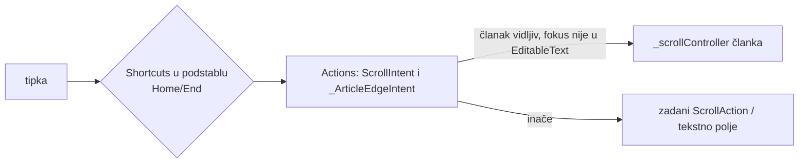

# Home / End / PageUp / PageDown na ekranu epizode (v2.0.207)

Desktop korisnik očekuje da tipke stranice pomiču članak, kao u pregledniku.
Flutter nema DOM koji bi to radio sam. Rješenje:
`lib/widgets/article_page_keys.dart` (`ArticlePageKeys`), omotan oko
`_EpisodeContentState.build` u `lib/screens/episode_screen.dart`.

## Zašto zadano ponašanje ne radi

- `WidgetsApp` veže PageUp/PageDown i strelice na `ScrollIntent`, ali
  `ScrollAction` pomiče scrollable u kojem je **fokus** (ili
  `PrimaryScrollController`, koji na desktopu nije automatski naslijeđen).
  Na epizodi je fokus na scopeu rute (ništa se ne pomakne) ili u panelu
  playera (pomakne se popis poglavlja).
- Home/End Flutter ne veže za scroll; `ScrollIncrementType` ima samo
  `line` i `page`.

## Kako radi

- `ScrollIntent` u podstablu ide u kontroler članka. `_ArticleScrollAction`
  nasljeđuje `ScrollAction` i pada na `super` kad tipka nije njegova, jer
  `Actions.maybeFind` vraća PRVU nađenu akciju bez obzira na `isEnabled`, pa
  „isključena" akcija ne propušta na zadanu.
- Home/End imaju vlastiti intent. Kad je akcija isključena, `ShortcutManager`
  vrati `ignored` i tipka putuje dalje do `DefaultTextEditingShortcuts`, pa
  kursor u polju i dalje radi.
- Pomaci su kao Flutterovi: stranica = 80 % viewporta, redak = 50 px,
  `moveTo` 100 ms.
- End radi `jumpTo(max)` i ponavlja ga do 5 frameova, jer je
  `maxScrollExtent` lijene sliver liste procjena koja raste kako se dno gradi.
- `active`: `_mobileTab == 0` i panel ne prekriva članak
  (`EpisodePanelCanvasState.centerHidden`).
- Skrol tipkom ne postavlja `_scrollLock`, pa ga `_onScroll` računa kao ručni
  i zaustavi odjavnu špicu. To je namjerno.

## Zamke

- **Fokus mora biti u podstablu.** `Focus(autofocus: true)` nije dovoljan:
  `TextField` na `unfocus()` preda fokus scopeu rute i tipke tada ne stignu do
  `Shortcuts`. `_reclaimFocus` (listener na `FocusManager`) vrati fokus kad
  `primaryFocus == _focus.enclosingScope`, i to post-frame, samo dok je ruta
  `isCurrent` (modal ostaje netaknut).
- **`HardwareKeyboard.addHandler` NIJE zamjena.** `KeyEventManager` zove i
  handlere i fokus sustav (`keyMessageHandler`), čak i kad handler vrati
  `true`. Globalni handler bi zato PageDown odradio dvaput kad je fokus u
  scrollableu.
- media_kit desktop kontrole hvataju strelice (skok, glasnoća) dublje u
  stablu, pa one tamo i dalje pobjeđuju; Home/End/PageUp/PageDown ne veže.

## Provjereno

- `test/article_page_keys_test.dart`: 4 testa.
- Lokalni `--wasm` build na 1400 px, `/v/aue1GuuMsbA` uz reprodukciju: End →
  Metapodaci, Home → vrh, PageDown → jedan ekran.

## Otvoreno

- Space / Shift+Space (preglednik njima lista stranicu) nisu vezani. Na webu
  je Space u zadanim prečacima `ActivateIntent`/`ScrollIntent`; prije
  vezivanja provjeriti da ne sudara s play/pause u media_kitu.
- Ostali ekrani (naslovnica, kanal, osoba) nemaju ovo. Widget je generički
  (`controller` + `active`), pa se može omotati oko njihovog glavnog scrolla.
- Uski ekran / tablet s tipkovnicom nije ručno isproban.
