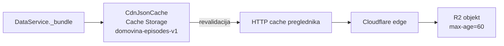

# Zastarjeli `episode.json` na webu + skriveni gumb `?osvjezi=1` (29.10.2026.)

## Simptom

`/v/MNk-eEpDb3E/t/934/en` na Windows Braveu: pipeline je ujutro dodao
`article.magisterium.json` (u `episode.json` od 05:33 UTC), ali se Magisterium u
aplikaciji nije pojavio. Ctrl+Shift+R nije pomogao. Pomoglo je tek DevTools →
Network → „Disable cache" + „Clear cache" + reload.

## Tri sloja cachea i tko je kriv



| sloj | stanje 29.10. | briše ga |
|---|---|---|
| Cache Storage (`CdnJsonCache`) | stari `episode.json` bez Magisteriuma | gumb `?osvjezi=1`, DevTools „Clear site data" |
| HTTP cache preglednika | kopija od 05:01, `max-age=3600` | samo DevTools / postavke preglednika; JS ga može samo **prepisati** |
| CF edge | `edge_ttl` 1 dan (zonsko pravilo) | purge obje `Vary: Origin` varijante |
| R2 | ispravno, `max-age=60` | — |

**Glavni krivac je zonsko Cache Rule „CDN /data tekst"**
(`fetch.domovina.tv/setup_cdn_cache_rule.sh`, 25.8.2026.). Za sve
`/data/*.json|md|srt` postavlja `browser_ttl` 3600 s i `edge_ttl` 1 dan
(`override_origin`). Browser TTL override vrijedi samo kad je dulji od
originova. Zato immutable datoteke zadrže godinu dana, a promjenjive
(`episode.json`, `reels*.json`, kojima uploader daje 60 s) dobiju sat vremena.
Komentar u skripti tvrdio je da browser override „ne radi na našem planu". To je
zastarjelo: 29.10. je radio.

Kako je izmjereno:

```bash
# CDN zaglavlje (bilo: max-age=3600)
curl -sD- -o/dev/null -H "Origin: https://domovina.ai" \
  https://cdn.domovina.ai/data/MNk-eEpDb3E/episode.json | grep -i cache-control
# R2 metapodaci (HeadObject, kredencijali iz fetch .env) → max-age=60
```

U pregledniku je običan `fetch` vraćao `last-modified 05:01`, a
`fetch(u, {cache:'no-cache'})` je vraćao `05:33` s Magisteriumom.

## Popravci

1. **Treće cache pravilo „CDN /data promjenjivo"** (ide iza /data/ pravila pa ga
   nadjačava): `episode.json`, `reels.json`, `reels.en.json` → `respect_origin`
   za edge i browser. Primijenjeno na zonu. Popis mora pratiti `cacheControlFor`
   u `upload_to_r2.js`.
2. **`DataService._get` ne vjeruje popisu sa diska za 404.** Kad stari
   `episode.json` kaže da datoteke nema, pričeka revalidaciju
   (`CdnJsonCache.revalidation(url)`) i, ako je svježi popis ima, dohvati je u
   istom učitavanju. Čuva `test/episode_bundle_stale_disk_test.dart`. Ovo
   pomaže samo ako revalidacija dobije svjež odgovor, a to je do popravka 1
   bilo najviše sat vremena kasnije.
3. **Skriveni gumb „Osvježi sve podatke"** (`services/refresh_all.dart`,
   `widgets/refresh_all_button.dart`, u `MaterialApp.builder`):
   - `?osvjezi=1` ga pali i pamti u localStorage, `?osvjezi=0` gasi;
   - klik: memorija `DataService`, `imageCache`, pa `hardReload(stayHere: true)`;
   - `hardReload` **prvo** ponovno dohvati svaku adresu iz `domovina-*` Cache
     Storagea uz `cache: 'reload'` i **pročita tijelo**, a tek onda briše
     Cache Storage, odjavi SW i napravi `location.reload()`. Prijava
     (localStorage) ostaje.

## Zamke koje su koštale vremena

- **Prvo sam krivio Cache Storage.** Gumb v2.0.215 ga je brisao i nije pomogao,
  jer je stara kopija stizala iz HTTP cachea. Pouka: prvo usporedi CDN
  zaglavlja s R2 `HeadObject`. Kad se razlikuju, krivo je zonsko pravilo.
- **`fetch(cache:'reload')` bez čitanja tijela ne upiše cache.** Reload prekine
  prijenos. Mjereno lokalno (Resource Timing, buffer podignut na 5000): bez
  `arrayBuffer()` je prije reloada stiglo 6 od 56 adresa, s njim 56 od 56.
- **Zadani Resource Timing buffer je 250.** Za ovakvo mjerenje treba
  `performance.setResourceTimingBufferSize(5000)`, inače se novi unosi tiho
  gube.
- `refreshAll` je u prvoj verziji zvao `CdnJsonCache.clear()` prije
  `hardReload`, pa je popis adresa za prepisivanje bio prazan.

## Otvoreno

- Edge unosi spremljeni pod starim pravilom žive do 1 dan. Pipeline ih purgea
  pri promjeni, a ostali sami isteknu.
- U jednom lokalnom testu prvi klik na gumb nije reagirao, a drugi jest. U
  zadnjem testu proradio je iz prve. Nije reproducirano ni objašnjeno.
- Na `/en` ta epizoda nema `article.magisterium.en.json`. Ako se Magisterium na
  EN prikazu ne vidi, uzrok je nedostajući prijevod, ne cache.

## Vezani dokumenti

- `docs/2026-10-08-brzina-ucitavanja-naslovnice.md` (`CdnJsonCache`, `episode.json` §8)
- `docs/2026-09-19-cachiran-404-vary-origin.md` (dvije `Vary: Origin` varijante)
- `fetch.domovina.tv/setup_cdn_cache_rule.sh`
