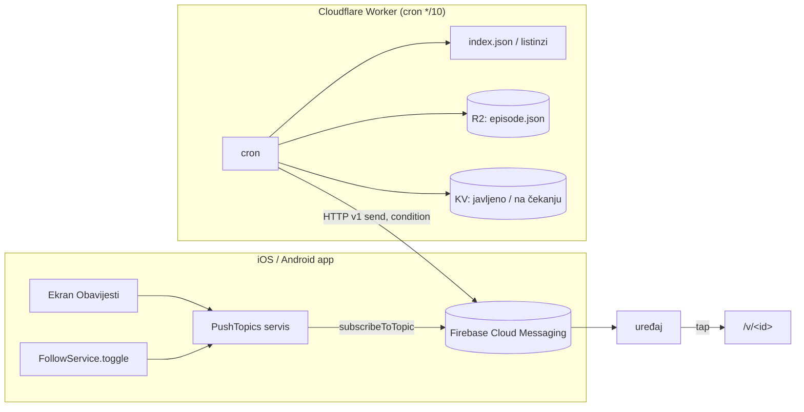

# Push obavijesti o novim epizodama — plan

Datum: 15. 10. 2026. Status: **implementirano 15. 10. 2026.** — klijent u `main`u (čeka build u storeu), Worker `domovina-push` deployan u `DRY_RUN=1`. Stanje infrastrukture: §10.

## 1. Cilj i odluke

Korisnik dobiva push kad na DOMOVINA.ai stigne nova epizoda koja ga zanima.
Odluke dogovorene 15. 10. 2026.:

| # | Odluka |
|---|---|
| D1 | Tko dopusti obavijesti, po defaultu je pretplaćen na **„Sve nove epizode”** + kanale koje prati. |
| D2 | Postoji **zaseban ekran Obavijesti** na kojem korisnik točno bira na što je pretplaćen. |
| D3 | Tihi sati **22:00–07:00** po `Europe/Zagreb`; epizoda koja stigne u tom prozoru čeka 07:00. |
| D4 | Firebase ide u postojeći GCP projekt **`domovina-production`** (isti koji drži Play service account i RevenueCat Pub/Sub). |
| D5 | Prvi krug: **iOS + Android**. Web, macOS i Android TV bez pusha. |

## 2. Koliko obavijesti

Izmjereno 15. 10. 2026. nad svih 50 listinga (`channels/data/<id>.json`, polje
`date`), razdoblje 15. 9. – 15. 10.:

- 54 epizode u 30 dana → **1,8 dnevno**, najviše **4** u danu;
- aktivno 17 kanala (`radio_mreznica` i `podcast_cuspajz` po 8).

Zato „Sve nove epizode” kao default ne zatrpava korisnika, i dnevni sažetak
(digest) nije potreban. Ako promet naraste iznad ~6 dnevno, digest se vraća na stol.

Reprodukcija:

```bash
mkdir -p /tmp/ch && curl -s https://cdn.domovina.ai/channels/data/index.json -o /tmp/ch/index.json
python3 -c "import json;[print(c['id']) for c in json.load(open('/tmp/ch/index.json'))['channels']]" \
  | xargs -P6 -I{} curl -s -A 'Mozilla/5.0' -o /tmp/ch/{}.json https://cdn.domovina.ai/channels/data/{}.json
python3 - <<'EOF'
import json,glob,collections
d=collections.Counter()
for f in glob.glob('/tmp/ch/*.json'):
    if f.endswith('index.json'): continue
    for v in json.load(open(f)).get('videos',[]):
        if str(v.get('date',''))[:10] >= '2026-09-15': d[v['date'][:10]] += 1
print(sum(d.values()), d.most_common(3))
EOF
```

(`python urllib` bez `User-Agent` dobije 403 od Cloudflarea — zato curl.)

## 3. Arhitektura: FCM teme, bez baze uređaja



**Zašto teme**: FCM sam drži pretplate i radi fan-out. Mi ne spremamo tokene,
nema tablice `push_devices` ni promjene u `domovina-api`. Radi i za goste, a to je
99 % korisnika.

**Zašto Cloudflare Worker, a ne Edge Function**: slanje ne čita ni ne piše našu
Postgres bazu → po pravilu iz CLAUDE.md („Backend placement”) ide u Worker.
Pages worker (`web/_worker.js`) nema cron trigger, pa je to **zaseban Worker**,
po uzoru na `../domovina-analytics` (prijedlog imena repoa: `domovina-push`).

### 3.1 Imena tema

| Tema | Značenje |
|---|---|
| `ep_all` | sve nove epizode |
| `ep_c_<channelId>` | nova epizoda kanala (interni id, npr. `ep_c_slijedi_svoj_poziv_2`) |
| `ep_test` | samo za ručne provjere na farmi uređaja |

FCM dopušta `[a-zA-Z0-9-_.~%]+`, a interni channel id je `[a-z0-9_]`, pa ga ne
treba kodirati. Teme su po Firebase projektu, pa se Podcasterium (drugi projekt)
ne sudara s DOMOVINOM.

### 3.2 Jedno slanje, nikad duplikat

Worker šalje **jednu** poruku po epizodi s uvjetom:

```
'ep_all' in topics || 'ep_c_<channelId>' in topics
```

Uređaj pretplaćen na obje teme dobiva jednu obavijest. Uvjet prima do 5 tema,
pa kasnije u isti uvjet stanu i osobe (`ep_p_<slug>`, faza 2).

## 4. Klijent

### 4.1 Paketi i platforme

- `firebase_core`, `firebase_messaging` (17, traži Android minSdk 24 i iOS
  15). Bez `flutter_local_notifications`: iOS u prednjem planu prikazuje kroz
  `setForegroundNotificationPresentationOptions`, Android u prednjem planu
  namjerno ništa ne prikazuje (korisnik je već u aplikaciji).
<!-- doc-refs:ignore-start -->
- Ljuska: `android/app/google-services.json`, `ios/Runner/GoogleService-Info.plist`
  (iz `domovina-production`). Opcije idu kroz `flutterfire configure` u ljusku, ne u
  `podcast_core`.
<!-- doc-refs:ignore-end -->
- **iOS**: capability Push Notifications (`aps-environment` u
  `Runner.entitlements`), Background Modes → `remote-notification`, APNs Auth
  Key (.p8) upisan u Firebase konzolu.
- **Android**: `POST_NOTIFICATIONS` (API 33+), zaseban kanal `new_episodes`
  („Nove epizode”). Ne smije se miješati s kanalom koji koristi `audio_service`
  (`lib/services/background_audio.dart`).
- **Isključeno**: web (`kIsWeb`), macOS, Android TV (Leanback). `PushTopics` je
  tamo no-op, a ulaz u ekran se ne prikazuje.
- **White-label**: jezgra ne zna za Firebase. Ljuska preda `PushTransport`
  kroz `runPodcastApp(pushTransport:)` (isti obrazac kao `AuthProviderPlugin`);
  bez njega `PushTopics.available == false` i ekran kaže „samo u aplikaciji”.
  DOMOVINA implementacija je `lib/push/firebase_push_transport.dart` u ljusci,
  pa Podcasterium ljuska ne vuče Firebase.
- Web ne uvozi Firebase u Dart kod: `main.dart` bira transport conditional
  importom (`if (dart.library.io)`), a web dobije stub koji vraća `null`.
  `firebase_*_web` pluginovi se i dalje registriraju; `flutter build web --wasm`
  prolazi i naslovnica se podiže bez grešaka (provjereno 15. 10. 2026.).

<!-- doc-refs:ignore-start -->
### 4.2 `PushTopics` servis (novo, `lib/services/push_topics.dart`)
<!-- doc-refs:ignore-end -->

Jedini koji zove `subscribeToTopic` / `unsubscribeFromTopic`.

- **Izvor istine je lokalan**: `push_topics_v1` (JSON), preko `local_prefs.dart`
  / `SharedPreferences` kao `FollowService`. FCM nema API za čitanje pretplata.
- **Rekoncilijacija na svakom startu** (i na `onTokenRefresh`): pretplati sve iz
  lokalnog skupa. `subscribeToTopic` je idempotentan, a reinstalacija ili novi
  token inače tiho izgube pretplate.
- **Sprega s praćenjem**: `FollowService.toggle` (`lib/services/follow_service.dart`)
  pri **praćenju** kanala dodaje `ep_c_<id>` ako je push dopušten, a pri
  **otpraćivanju** ga miče. Obrnuto ne vrijedi: isključiti obavijest za kanal
  na ekranu Obavijesti NE otpraćuje kanal (rail „Novo od praćenih” ostaje).
- **Pri prvom dopuštenju** (D1): `ep_all` + `ep_c_*` za sve već praćene kanale.

### 4.3 Ekran Obavijesti (D2)

Ruta **`/obavijesti`** (u stilu `/glasanje`), top-level kao i ostale, pa je
dosežna izravnim URL-om (pravilo iz CLAUDE.md, „Routing”). Ulaz: redak na
`/account` (`lib/screens/account/account_screen.dart`) i deep link iz kartice
na naslovnici. Ulaz ide kroz `drillDown`.

Raspored:

1. **Stanje dozvole** (gornja kartica):
   - nije pitano → objašnjenje + gumb „Uključi obavijesti” (tek ON poziva
     sistemski dijalog);
   - odbijeno → „Obavijesti su isključene u postavkama uređaja” + gumb koji
     otvara sistemske postavke aplikacije. Sve ispod je tada onemogućeno, ali vidljivo;
   - dopušteno → kartica se svodi na jedan redak.
2. **„Sve nove epizode”** — prekidač (`ep_all`), s podnaslovom „Otprilike 1–4
   dnevno”.
3. **Kanali** — popis svih kanala iz `index.json` s prekidačem po kanalu
   (`ep_c_<id>`). Praćeni kanali su prvi, ostali abecedno, uz pretragu.
   - Dok je „Sve nove epizode” uključeno, prekidači kanala su prikazani kao
     uključeni i onemogućeni, uz natpis „Uključeno kroz Sve nove epizode”. Iz
     teme se ne može izuzeti kanal; za to korisnik isključi „Sve” i bira
     pojedinačno.
4. **Tihi sati** — informativni redak „Ne šaljemo između 22 i 7 h” (D3, globalno
   na serveru; korisničko podešavanje nije u prvom krugu).

Copy: neformalno „ti”, bez emojija, ikone su `Icons.*`, ključevi s prefiksom
`notifications*` u oba ARB-a.

### 4.4 Kad pitati za dozvolu

**Nikad pri pokretanju i nikad modalom** (pravilo „nudge ne prekida
reprodukciju” / persistent surface). Sistemski dijalog se otvara samo na
korisnikov tap:

- gumb „Uključi obavijesti” na ekranu Obavijesti;
- tap na „Pratim” kad dozvola još nije tražena: praćenje se izvrši, a ispod
  gumba se pojavi trajni chip „Javi mi za nove epizode” (tap → dijalog);
- trajna kartica na naslovnici („Javi mi kad stigne nova epizoda”) koja se
  može odbaciti i ne vraća se 30 dana.

### 4.5 Tap na obavijest

`data.route = "/v/<videoId>"`. Rukuje se s tri stanja: aplikacija u prednjem
planu (`onMessage` → lokalna obavijest), u pozadini (`onMessageOpenedApp`) i
ugašena (`getInitialMessage` pri bootu, nakon što se ruter napravi). Navigacija
ide kroz postojeći ruter (`lib/router/app_router.dart`), kao deep link.

## 5. Worker `domovina-push`

### 5.1 Ciklus (cron `*/10 * * * *`)

1. Pročitaj `channels/data/index.json` (R2). Listing se čita za svaki kanal
   čiji je `latest_video.date` u prozoru — tako ni kanal s dvije objave u istom
   ciklusu ne izgubi jednu, a epizoda odgođena tihim satima ostane kandidat.
2. Kandidat je epizoda koja ispunjava sve:
   - `date` unutar zadnja **4 dana** (`MAX_AGE_DAYS`; `date` je dan objave na
     YouTubeu, a obrada zna kasniti — zaštita od backfilla starog kataloga);
   - nema je u KV-u `sent:<videoId>`.
3. **Spremnost se mjeri, ne čita iz listinga** (pravilo „pipeline zastavice ≠
   stvarnost”): `data/<id>/episode.json` postoji i navodi medij (`video_h264*`
   ili `audio.mp3`) i `article.json`. Čita se kroz **R2 binding**, ne preko CDN-a,
   pa cachirani 404 s `Vary: Origin` ne postoji. Ako nije spremna, nema upisa
   i provjera se ponavlja sljedeći ciklus.
4. Tihi sati: između 22 i 7 h po `Europe/Zagreb` ciklus ne radi ništa. Epizode
   ostaju kandidati (nisu u `sent:`), pa ih šalje prvi ciklus nakon 07:00.
5. Slanje (FCM HTTP v1). Nakon `200` upiši `sent:<videoId>` (TTL 30 dana).

### 5.2 Osigurači

- **Prvo pokretanje samo puni KV** (`seeded` flag): sve postojeće epizode se
  upišu kao poslane, ništa ne ode.
- **Najviše 6 slanja po ciklusu.** Višak ostaje za sljedeći ciklus i zapisuje
  se u log Workera (observability).
- `DRY_RUN=1` env: logira poruke umjesto slanja.
- Ručno slanje na `ep_test` za provjeru na farmi uređaja.

### 5.3 Poruka

```json
{
  "message": {
    "condition": "'ep_all' in topics || 'ep_c_radio_mreznica' in topics",
    "notification": {
      "title": "Radio Mrežnica",
      "body": "<title_hr || title epizode>",
      "image": "https://cdn.domovina.ai/images/<id>/thumb-640.webp"
    },
    "data": { "route": "/v/<id>", "videoId": "<id>", "channelId": "radio_mreznica" },
    "android": { "notification": { "channel_id": "new_episodes", "tag": "<id>" } },
    "apns": { "headers": { "apns-collapse-id": "<id>" },
              "payload": { "aps": { "mutable-content": 1 } } }
  }
}
```

Naslov se ne prevodi (pravilo: naslov epizode je izvorni), pa EN korisnik dobiva
isti tekst.

**Slika na iOS-u traži Notification Service Extension** (zaseban target u
`ios/`). U prvom krugu iOS prikazuje samo tekst; NSE je faza 2. Android sliku
prikazuje bez dodatnog koda.

### 5.4 Tajne

`FCM_SERVICE_ACCOUNT` (JSON, `wrangler secret`): service account u
`domovina-production` s ulogom *Firebase Cloud Messaging API Admin*, odvojen od
`play-publisher`. Worker iz njega sam potpisuje JWT i mijenja ga za OAuth token
(cache ~55 min u memoriji isolatea).

## 6. Pravni dokumenti i analitika (isti commit kao klijent)

Push uvodi novu obradu (Google Firebase kao izvršitelj, FCM token na uređaju i
kod Googlea; kod nas se ne sprema ništa). Po pravilu iz CLAUDE.md:

1. `docs/compliance/data-protection.md` — nova obrada, svrha, kategorije, rok;
2. `docs/compliance/store-privacy-labels.md` — Apple App Privacy / Google Data
   safety (konzole se upisuju ručno);
3. politika privatnosti: ARB (HR + EN) + `docs/compliance/privacy-policy-hr.md`
   + `legalLastUpdated`;
4. analitički događaji `push_permission_prompted|granted|denied`,
   `push_topic_changed` (`topic`, `on`), `push_open` (`videoId`) → redak u
   `domovina-analytics/docs/ugovor.md` i Obrada E.

## 7. Testovi i provjera

- Unit: imena tema, rekoncilijacija `PushTopics`, sprega praćenja s temom
  (praćenje dodaje, otpraćivanje miče, gašenje teme ne otpraćuje).
- Widget: ekran Obavijesti u tri stanja dozvole + onemogućeni kanali pod „Sve”;
  layout na 320 dp.
- Worker (vitest): diff `latest_video`, prozor 48 h, `seeded`, tihi sati preko
  ponoći i kroz promjenu ljetnog/zimskog vremena (25. 10. 2026.), ograničenje po
  ciklusu, epizoda koja nije spremna.
- Farma: ručni send na `ep_test` → tap otvara `/v/<id>` u sva tri stanja
  aplikacije na sva 4 uređaja. Hladni start ide u `nightly-smoke` kao ručni
  korak dok ga ne automatiziramo.

## 8. Redoslijed i procjena

| # | Korak | Procjena |
|---|---|---|
| 1 | Firebase u `domovina-production`: Android + iOS app, APNs ključ, service account | 0,5 h, ručno (korisnik u konzoli) |
| 2 | Klijent: paketi, platformske postavke, `PushTopics`, rukovanje tapom | 0,5 dana |
| 3 | Ekran `/obavijesti` + ulazi (account, chip uz „Pratim”, kartica na naslovnici) | 0,5 dana |
| 4 | Worker `domovina-push` (cron, KV, R2, FCM) + testovi, prvo `DRY_RUN` 2 dana | 0,5 dana |
| 5 | Pravni dokumenti + analitika | 0,25 dana |
| 6 | Provjera na farmi, nightly build, uključivanje slanja | 0,25 dana |

**Redoslijed puštanja**: klijent ide u store prvi (pretplate se skupljaju), a
Worker se pali tek kad ima pretplatnika. Do tada radi u `DRY_RUN`.

## 9. Faza 2 (nije u ovom krugu)

- Osobe: `ep_p_<slug>` iz `speakers` u listingu (treba mapiranje govornika na
  person slug).
- iOS Notification Service Extension za sliku.
- Korisnički tihi sati, digest ako promet naraste.
- Web push (VAPID; na iOS-u samo za PWA na početnom zaslonu; pretplata na temu
  ide preko Workera jer FCM web SDK nema `subscribeToTopic`).

## 10. Stanje infrastrukture (15. 10. 2026.)

| Što | Gdje |
|---|---|
| Firebase app Android `ai.domovina` | `1:326910620880:android:cc78d06e14c834ce689ad5` |
| Firebase app iOS `ai.domovina` | `1:326910620880:ios:e4af04c30e1be2d5689ad5` |
| FCM API | uključen u `domovina-production` |
| Service account za slanje | `push-sender@domovina-production`, uloga `roles/firebasecloudmessaging.admin`; JSON ključ postoji SAMO kao Worker tajna `FCM_SERVICE_ACCOUNT` |
| Push capability na App ID-u | `PUSH_NOTIFICATIONS` uključen kroz ASC API (bundle id `CB24KNJML2`) |
| APNs Auth Key | `DRC6JVC539` („DOMOVINA Push APNs”, tim `6SCK58757K`, Sandbox & Production). U Firebase konzoli upisan kao **production** ključ (15. 10. 2026.); isti `.p8` treba upisati i u redak **development** — bez njega debug build s uređaja (`aps-environment = development`) ne prima push. `.p8` čuva vlasnik (`~/secrets/`); agentu je preuzimanje ključa blokirano |
| Worker repo | [`domovinatv/domovina-push`](https://github.com/domovinatv/domovina-push) (javni; tajna je samo u Workeru) |
| Worker | `domovina-push`, cron `*/10`, R2 `cdn-domovina-ai`, KV `a2bcc79eddb04ff8b78520b9fbad7717`, `DRY_RUN=1`; prvi prolaz (15. 10.) zapamtio 7 epizoda (`seeded`) |

Provjera slanja: poruka na temu `ep_test` vratila je `projects/domovina-production/messages/…`
(IAM uloga je trebala ~5 min da proradi; do tada 403 `cloudmessaging.messages.create`).

**Puštanje u rad**: kad build s pushom prođe review, u `wrangler.jsonc` postavi
`DRY_RUN` na `"0"` i `npx wrangler deploy`. Do tada log Workera
(`npx wrangler tail domovina-push`) pokazuje što BI bilo poslano.
