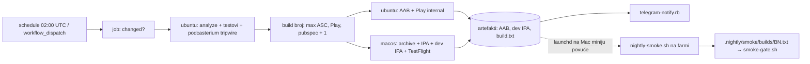

# Store build na GitHub Actions (plan, 9. 11. 2026.)

Status: **plan, ništa nije implementirano.** Smoke i promocija ostaju na Mac
miniju; u cloud se seli samo build + upload.

## 1. Povod

Od 5. 11. do 9. 11. 2026. na storeove nije otišao nijedan build: web je na
v2.0.222, TestFlight i Play internal na 2.0.218 (241, 4. 11.). Nightly je pao
svaku noć od 6. 11. (i ručni `--force` 7. 11.) na istom mjestu: `ibtool`
(CompileStoryboard) visi, watchdog prekida „iOS build (IPA)" nakon 60 min, a
Android se ne gradi jer koraci idu redom (iOS prvi).

Uzrok (vjerojatan, nije dokazan do kraja): 5. 11. u 16:54 su
`/Library/Developer/CoreSimulator/{Images,Cryptex,Caches}` postali symlinkovi na
`/Volumes/DOMOVINA2TB/ios_simulators/` (interni disk ima 3,8 GB slobodno).
Nakon toga nijedan simulator runtime nije montiran
(`/Library/Developer/CoreSimulator/Volumes` prazan), `xcrun simctl list` visi,
a pristup tom direktoriju vraća `Operation not permitted` (TCC na vanjskom
volumenu). `ibtool` za iOS storyboard pokreće IBAgent unutar simulator
runtimea, pa archive za FIZIČKI uređaj svejedno treba runtime. `Devices` je
vani od 15. 10. i to je radilo — uređaji ne trebaju, runtime treba.

Lokalni stroj je jedna točka kvara koja se pokvari tiho (TCC, keychain,
CoreSimulator, pun disk). Čisti runner svaki put taj razred kvarova nema.

## 2. Zašto Actions ima smisla baš ovdje

- Repo `domovinatv/domovina.ai` je **PUBLIC**. Standardni GitHub-hosted runneri
  (uključujući macOS) su za javne repoe besplatni, bez kvote minuta. Free plan:
  ~20 paralelnih jobova, od toga ~5 macOS; 6 h po jobu. (Brojke iz poznavanja
  GitHubove politike, provjeriti na docs.github.com prije Faze 1.)
- Potreba: jedan build dnevno. Danas ~62 min za oba OS-a na Mac miniju; na
  standardnom macOS arm64 runneru (3 vCPU, 7 GB) očekivano 25–40 min za iOS,
  Android paralelno na `ubuntu-latest`.
- `flutter_certilia` je path ovisnost `../../stepanic/flutter_certilia`, repo
  je PUBLIC → checkout na istu relativnu putanju, bez tokena.

## 3. Ciljna arhitektura

- Android i iOS su **paralelni jobovi** — pad jednog ne blokira drugi (danas blokira).
- Build broj se računa JEDNOM u zasebnom jobu i prosljeđuje kao output; oba
  joba koriste isti broj (inače utrka).
- Smoke ostaje lokalan: fizički uređaji. Mac mini (launchd, kao sad) pita
  `gh run list --workflow store-build` za zadnji uspješan run, `gh run download`
  AAB + dev IPA, vrti `scripts/nightly-smoke.sh <build>`. Vrata na promociji
  (`smoke-gate.sh`, `asc-submit.rb`, `play-promote.sh`) se ne mijenjaju.
- **Self-hosted runner NE** — na javnom repou kod iz forka može doći do stroja.

## 4. Tajne (GitHub Secrets, environment `store`)

| Danas (lokalno) | Secret |
|---|---|
| `.env`: `SUPABASE_URL`, `SUPABASE_ANON_KEY`, `RC_PUBLIC_SDK_KEY_IOS`, `RC_PUBLIC_SDK_KEY_ANDROID` (+ ostali `--dart-define` koje `build-mobile-release.sh` čita) | isti nazivi |
| `~/.appstoreconnect/private_keys/AuthKey_25KYCN22QD.p8` | `ASC_KEY_P8` (base64); `ASC_KEY_ID`, `ASC_ISSUER_ID` |
| `android/key.properties` + upload keystore | `ANDROID_KEYSTORE_B64`, `ANDROID_KEY_PROPERTIES` |
| `~/.config/play-publisher/domovina-play-publisher.json` (`PLAY_SA_KEY`) | `PLAY_SA_JSON` |
| Telegram bot token + chat id (iz `.env`) | isti nazivi |

Pravila:
- Workflow okida SAMO `schedule` i `workflow_dispatch` (+ eventualno `push` na
  `main`). **Nikad `pull_request_target`**, nikad tajne u jobu koji pokreće PR.
- Environment `store` s ograničenjem na granu `main`.
- Sav izlaz prema Telegramu i dalje kroz `scripts/telegram-notify.rb`
  (redigira `.env` vrijednosti); log Actionsa je javan, pa `set -x` zabranjen
  u koracima s tajnama, a `--dart-define` vrijednosti se maskiraju
  (`::add-mask::`).

## 5. Faze

**F0 — preduvjet, lokalno (neovisno o ovom planu).** Vratiti runtime na interni
disk: osloboditi mjesto (iOS 18.1 runtime je višak; Xcode gradi s iOS 26 SDK),
`Images` + `Cryptex` natrag kao pravi direktoriji, `Devices` ostaje vani,
restart, `gtimeout 30 xcrun simctl list devices booted` mora odgovoriti,
`pkill -f 'usr/bin/(ibtool|ibtoold|actool)'`, `nightly-build.sh --force`.
Lokalni nightly ostaje ugašen tek kad F3 dva tjedna radi.

**F1 — Android u Actionsu.** `.github/workflows/store-build.yml`: gate
(SHA ≠ zadnji uspješan run), test job (`cd packages/podcast_core && flutter
test` uz `.nightly/test-baseline.txt` logiku iz `nightly-build.sh`), Android job
(`build-mobile-release.sh android`, `play-upload.sh internal`). Cache:
pub (`~/.pub-cache`), Gradle. Flutter verzija pinana na lokalnu
(`subosito/flutter-action` s točnom verzijom). Prvo `--skip-upload`
ekvivalent (`inputs.upload=false`), pa upload.
Gotovo kad: jedan run donese novi versionCode na internal, a lokalni nightly
istu noć ne uploada Android (zastavica `NIGHTLY_SKIP_ANDROID=1` u launchd
plistu, treba je dodati u skriptu).

**F2 — iOS u Actionsu.** macOS runner sa slikom koja ima Xcode s iOS 26.x SDK
(`xcode-select` na točnu verziju). Signing ide već danas kroz ASC API key
(`-allowProvisioningUpdates -authenticationKey*` u `build-mobile-release.sh`) —
**rizik za provjeru**: archive na čistom stroju bez ijednog certifikata u
keychainu. Dobar znak: ni na Mac miniju privatni ključ distribucijskog
certifikata nije lokalan (`docs/nightly-build-pipeline.md`, „Poznate zamke”),
pa potpisivanje već danas ide kroz Appleov cloud signing. Ako cloud signing ne pokrije archive, uvozi se distribution cert
(`.p12` kao secret) u privremeni keychain. CocoaPods cache. Dev IPA
(`EXPORT_DEV_IPA=1`) ide kao artefakt za smoke. `testflight-upload.sh` exit 3
(zatvoren train) mora oboriti job s jasnom porukom.
Gotovo kad: build se pojavi na TestFlightu kao `VALID`.

**F3 — smoke povlači artefakt.** Lokalni `nightly-build.sh` dobiva način rada
`--from-actions`: bez builda, `gh run download` zadnjeg uspješnog runa, provjera
da build broj odgovara `store-status.rb`, pa postojeći korak smokea i
Telegram. Zaključavanje uređaja (`~/.device-farm/locks/`) ne mijenja se.
Gotovo kad: `.nightly/smoke/builds/<BN>.txt` s `result=pass` za build iz Actionsa
i `smoke-gate.sh` ga prihvati.

**F4 — gašenje lokalnog builda.** Nakon dva tjedna bez ručne intervencije:
launchd job prelazi na `--from-actions`, ažurirati
`docs/nightly-build-pipeline.md` i sekciju „Nightly store build" u `CLAUDE.md`.

## 6. Otvorena pitanja

- Točna Xcode verzija koju slika runnera nudi kad Apple podigne minimalni SDK.
- Trajanje iOS archivea na 3-jezgrenom runneru (mjeriti u F2; ako > 60 min,
  watchdog/timeout-minutes podesiti, ne optimizirati unaprijed).
- Podcasterium tripwire u Actionsu traži checkout `podcasterium/podcasterium-app`
  — provjeriti je li taj repo javan; ako nije, treba deploy key ili korak ostaje
  lokalan.
- Retencija artefakata (default 90 dana za javne repoe) — dovoljno je 14.
