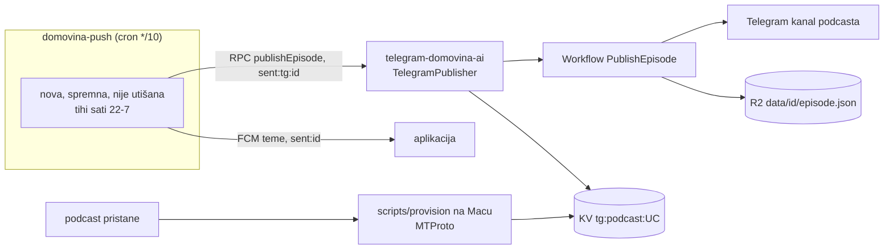

# Telegram kanal po podcastu — plan

Datum: 19. 11. 2026. Status: **oba Workera deployana 19. 11.** (`telegram-domovina-ai`
6e67e22b, `domovina-push` d6500eb0); bot, `TELEGRAM_BOT_TOKEN` i Domovina Telegram račun još
ne postoje, nijedan kanal nije stvoren (§6). Dok kanala nema, svaka epizoda dobiva
`sent:tg:<id>` = `no_channel`. Nastavlja
[`2026-10-15-push-nove-epizode.md`](2026-10-15-push-nove-epizode.md): Telegram je drugi
dostavljač istog toka obavijesti.

## 1. Cilj i odluke

Podcast koji pristane dobiva vlastiti Telegram **kanal** u kojem stoji svaka njegova
nova epizoda i sva njena poglavlja (svaka poruka vodi točno na taj trenutak na
domovina.ai), i uz njega povezanu **grupu za raspravu** (komentari ispod svake objave).
Cilj je retencija: korisnik koji se pridruži kanalu vraća se na domovina.ai.

| # | Odluka (19. 11. 2026.) |
|---|---|
| T1 | Kanal + povezana grupa za raspravu (`channels.SetDiscussionGroup`), ime „<Podcast> · domovina.ai”. |
| T2 | **Samo uz pristanak podcasta.** Kanal se stvara ručno kad podcast pristane; postojanje kanala je zapis pristanka. |
| T3 | Vlasnik kanala i grupa je **zaseban Domovina Telegram račun**, ne osobni; poruke šalje **vlastiti bot domovina.ai** (ne ms-social-poster). |
| T4 | Tier 1 i Tier 2: sve što `domovina-push` vidi kao novu epizodu. |
| T5 | **`domovina-push` ostaje glavni usmjerivač** svih obavijesti i zadržava ime. Telegram je dostavljač u zasebnom javnom repou `domovinatv/telegram.domovina.ai`, jer tamo živi sve što je samo Telegramovo (MTProto, račun, bot, mapiranje). |
| T6 | Kanal dobiva samo epizode objavljene od dana kad je nastao (pravilo „samo nove epizode”). |

Odbačeno: zaseban `notifications.domovina.ai` od nule (dupliciralo bi odluku koju
`domovina-push` već donosi), i petlja na Macu iza nightlyja (čitala je disk umjesto CDN-a
i nije poštovala postavke kanala). Korisničko podešavanje obavijesti kasnije ide u
domovina.ai, ne u zaseban landing.

## 2. Arhitektura

- **Ključ je YouTube `channel_id`** (UC…), čita se iz `episode.json`
  (`inline["info.json"].channel_id`): radi za playliste bez `youtube_channel_url` i za
  Tier 2, kojem je slug u pipelineu `_unlisted`.
- **Svaki dostavljač ima svoj zapis** (`sent:<id>` za FCM, `sent:tg:<id>` za Telegram), pa
  kvar jednog ne zadržava ni ne ponavlja drugog. Telegram ne ovisi o `DRY_RUN` (taj čeka
  aplikaciju u storeu).
- **Utišavanje:** isključen `push_notifications` u postavkama kanala (ili povučen/obrisan
  kanal, `closeOff`) utišava i Telegram.
- **Tempo:** 30–46 poglavlja uz ~20 poruka u minuti traje 2–3 min, pa objava ide kroz
  Cloudflare Workflow s pauzom od 3 s; svaki korak je memoiziran, ponovni pokušaj nastavlja
  bez duplikata. Instanca `ep-<video>-<UC>` se ne može stvoriti dvaput.
- **Stvaranje kanala je MTProto** (Bot API to ne može), korisničkom sesijom Domovina
  računa, `teleproto` (nasljednik arhiviranog GramJS-a), točno pinana verzija.

## 3. Poruke

- Epizoda: `🎙 <b>naslov</b>`, sažetak (do 600 znakova), „N poglavlja slijedi u nastavku.
  Cijela epizoda: https://domovina.ai/v/<id>”, veliki pregled stranice epizode.
- Poglavlje (tiho): `⏱ <b>M:SS</b> · podnaslov` + `https://domovina.ai/v/<id>/t/<sec>`,
  veliki pregled (og:image je kadar tog trenutka).
- Nijedan link ne vodi na YouTube.

## 4. Gumb na domovina.ai (sljedeći korak, nije izgrađeno)

`GET https://telegram.domovina.ai/public/podcasts/<UC>` vraća `{title, link}` (CORS, 5 min
cache) ili 404. Stranica kanala i epizode može pokazati „Pridruži se na Telegramu” samo
kad kanal postoji.

## 5. Repoi i commiti

| Repo | Što |
|---|---|
| [`domovinatv/telegram.domovina.ai`](https://github.com/domovinatv/telegram.domovina.ai) | Worker `telegram-domovina-ai` (KV `PODCASTS`, R2 `cdn-domovina-ai`, Workflow), `scripts/provision` |
| [`domovinatv/domovina-push`](https://github.com/domovinatv/domovina-push) | dostavljač Telegram u ciklusu, service binding `TELEGRAM` |
| `fetch.domovina.tv/docs/2026-11-19-telegram-grupa-po-kanalu.md` | istraživanje (Bot API ne može stvoriti grupu, GramJS → teleproto, varijante) |

## 6. Puštanje u rad

1. BotFather: novi bot domovina.ai. Token → `npx wrangler secret put TELEGRAM_BOT_TOKEN`
   u `telegram.domovina.ai`, plus `API_TOKEN` (već u lokalnom `.dev.vars`).
2. ~~Deploy `telegram-domovina-ai`, pa tek onda `domovina-push` (service binding).~~
   Gotovo 19. 11.; `API_TOKEN` postavljen.
3. Domovina Telegram račun → `scripts/provision`: `npm run login`, u `.env` `TG_SESSION`
   i `TG_BOT_USERNAME`.
4. Prvi podcast koji pristane: `npm run create-channel -- <UC> --title "… · domovina.ai"
   --avatar https://cdn.domovina.ai/registry/avatars/<slug>.jpg`, pa ručni test
   `POST /podcasts/<UC>/episodes/<videoId>`. Provjeriti stvarne limite računa i `FLOOD_WAIT`.

## 7. Otvoreno

- [ ] Koraci §6.
- [ ] Gumb „Pridruži se na Telegramu” u aplikaciji/webu (§4).
- [ ] Opt-in ključ u postavkama kanala (samoposluga vlasnika) umjesto ručnog stvaranja,
      kad bude više od nekoliko podcasta.
- [ ] Rizik: `teleproto` i njegov nativni `cifrante` imaju jednog održavatelja, a dobivaju
      punu sesiju računa; nadogradnje samo uz pregled diffa.
