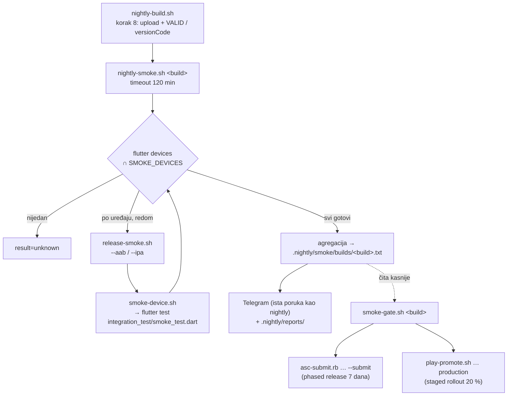
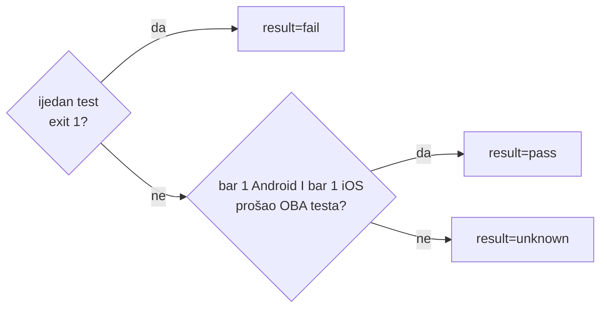
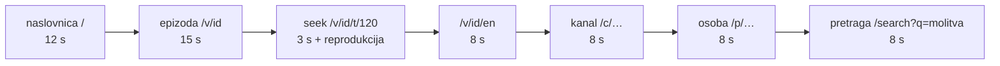

# Smoke testovi na uređajima farme — referenca

Stanje 12. 11. 2026., napisano iz samih skripti. Povijest, odluke i prva
mjerenja su u planu `docs/plans/2026-10-13-smoke-testovi-na-uredajima.md`
(zastario u brojkama: ondje su 4 uređaja i „prva vožnja tek predstoji”).
Mjesto smokea u nightlyju: `docs/nightly-build-pipeline.md`, korak 8b.

## 1. Što je smoke i zašto dvije razine

Nakon što nightly uploada build na TestFlight i Play internal, isti build se
pušta na pravim uređajima spojenima na Mac mini. Upload smoke NE blokira
(build je ionako interni); **vrata su na promociji u produkciju**.

Po uređaju idu dva testa, jer svaki vidi ono što drugi ne vidi:

| razina | skripta | što pokreće | što hvata |
|---|---|---|---|
| **release** | `scripts/release-smoke.sh` | ISTI binarni paket kao u storeu (AAB → APK preko `bundletool`; za iOS development export istog archivea) | R8/minifikacija, AOT, potpis, `--dart-define` koji fali u release skripti, nativni crash, ANR, `FLUTTER ERROR` iz release loga |
| **ui** | `scripts/smoke-device.sh` + `integration_test/smoke_test.dart` | debug build s istim defineovima iz `.env` | `ErrorWidget`, svaka Flutter greška (overflow!), reprodukcija koja ne napreduje, nativni crash ispod Darta |

Uređaji: oni iz `SMOKE_DEVICES` u `.env` (od 5. 11. 2026. edge 30 ultra i
iPhone 12 mini; id-evi nisu u gitu jer je repo javan). Prazno = sve što
`flutter devices` vidi, uključujući slučajno spojeni osobni telefon.

## 2. Tijek



Uređaji idu **jedan po jedan**: istodobni Flutter buildovi u istom projektu
dijele `build/` i ruše jedni druge. Zapis ide u glavni repo (prvi
`git worktree`), jer se nightly worktree briše svake noći; logovi po
uređaju i razini su u `.nightly/smoke/<build>/<id>-{release,ui}.log`.

### Ishod buildova



`unknown` nije prolaz: uređaj koji „nije provjeren” (zaključan, zauzet,
bez mreže) ne smije tiho propustiti build. `nightly-smoke.sh` izlazi s
0/1/2 za pass/fail/unknown; `nightly-build.sh` to prevodi u redak Telegrama
(s trajanjem u svakoj grani; 124/137 = prekinut timeoutom od 120 min).

### Format zapisa

```
result=pass
motorola edge 30 ultra: release ok (3 min 10 s), ui ok (5 min 02 s)
iPhone 12 mini: release ok (2 min 40 s), ui PAO (6 min 15 s)
   ↳ portrait epizoda-seek: reprodukcija ne napreduje (Video stoji, …)
ukupno: 17 min 07 s
```

Prvi redak čita `smoke-gate.sh`; ostatak je za čovjeka. Retke `↳` daje prvi
konkretan razlog iz loga (reprodukcija, overflow, nativni crash, zastoj…),
a tek ako ga nema općeniti `SMOKE:` / `RELEASE SMOKE` redak. Trajanje po
razini uključuje čekanje na bravu uređaja (§4). Zapisi prije 12. 11. 2026.
nemaju trajanja.

## 3. Što obara test — po razini

Exit kodovi su isti na svim razinama i znače isto: **0 prošlo, 1 aplikacija
je pokvarena, 2 ne mogu provjeriti**. „Ne mogu provjeriti” se nikad ne
broji kao pad aplikacije (to bi učilo ignorirati crveno), ali ni kao prolaz.

### 3.1 release (`release-smoke.sh`)

Rute (deep linkovi): start, `/v/<id>`, `/v/<id>/t/120`, `/v/<id>/en`,
`/c/40-dana-za-zivot`, `/p/marko-matijasevic`; po ruti 10 s čekanja i
screenshot (izlaz skripte, nije u gitu):

<!-- doc-refs:ignore-start -->
`.nightly/smoke/release/<device>/`
<!-- doc-refs:ignore-end -->


| platforma | kako se otvara ruta | orijentacija |
|---|---|---|
| Android | `am start -W -a VIEW -d https://domovina.ai<put> ai.domovina` (eksplicitni paket, da intent ne ode u browser bez verifikacije App Linka) | portrait pa landscape (`user_rotation`), dakle 12 koraka |
| iOS | `devicectl … process launch --terminate-existing --payload-url ai.domovina:///<put>` — svaka ruta je hladni start, tri kose crte | kako uređaj stoji (iOS orijentaciju izvana ne zadaješ); obje pokriva ui razina |

| exit | uvjet |
|---|---|
| **1** | proces ne postoji nakon koraka |
| **1** | Android: aplikacija nije u prvom planu (`topResumedActivity`) |
| **1** | nema `Video: opening` u logu aplikacije — ekran epizode nije pokrenuo player (na iOS-u jedini dokaz da tuđi sistemski dijalog nije prekrio aplikaciju) |
| **1** | novi crash zapis: Android `logcat -b crash`, iOS novi `Runner-*.ips` (`pymobiledevice3 crash ls`, razlika prije/poslije) |
| **1** | ANR (`logcat -b events`, `am_anr`), samo Android |
| **1** | `FLUTTER ERROR` u release logu (Android `logcat -s flutter`, iOS `idevicesyslog -p Runner`) |
| 2 | uređaj zauzet nakon 20 min čekanja na bravu |
| 2 | adb / `devicectl` ne vidi uređaj; Android bez mreže (`ping cdn.domovina.ai`) |
| 2 | uređaj zaključan (Android `isKeyguardShowing=true`, iOS `passcodeRequired: true`) |
| 2 | nema AAB-a / IPA-e, `bundletool build-apks/install-apks` ili `devicectl install` pao |

Android APK potpisuje `bundletool` debug ključem (kod je isti kao u Play
buildu), pa se postojeća instalacija prvo deinstalira.

### 3.2 ui (`smoke-device.sh` + `smoke_test.dart`)

Jedan `testWidgets` (singletoni iz `runPodcastApp()` se ne smiju dići
dvaput). Ruta se šalje kanalom kojim OS predaje deep link
(`flutter/navigation` → `pushRouteInformation`). Prolaz po orijentaciji,
prvo portrait pa landscape:



Na kraju sve orijentacije natrag i još jednom naslovnica (5 s). Ukupno
7 ruta × 2 orijentacije + 1 korak. `pumpAndSettle` se ne koristi (video,
skeletoni i karuseli animiraju stalno); pumpa se zadano vrijeme.

| exit | uvjet |
|---|---|
| **1** | `ErrorWidget` na ekranu nakon koraka |
| **1** | svaka Flutter greška koja nije mrežni šum (`NetworkImageLoadException`, `HttpException`, `SocketException`, `ClientException`, `HandshakeException`) — uključujući **RenderFlex overflow**; landscape je 13. 10. 2026. na iPhoneima uhvatio 5 overflowa koje portrait ne vidi |
| **1** | naslovnica bez `Scaffold`; epizoda nije na `/v/<id>` |
| **1** | reprodukcija ne napreduje: unutar 25 s pozicija mora biti ≥ 115 s i zatim narasti za ≥ 2 s (`playing` sam po sebi ne znači da frameovi stižu) |
| **1** | nativni crash ili ANR tijekom testa (isti izvori kao release) |
| **1** | `Some tests failed`, ili test završi s rc ≠ 0 bez boljeg objašnjenja |
| 2 | `SMOKE_NO_NETWORK`: proces aplikacije 60 s ne razrješava `cdn.domovina.ai` (Moto Secure skenira svježi APK; `adb ping` radi, aplikacija ne) |
| 2 | build ili pokretanje nije uspjelo (`Could not build the precompiled application`, `Unable to start the app`, `Error launching application`) — store build istog koda je već prošao, pa je to infrastruktura |
| 2 | zastoj: log 8 min ne raste |
| 2 | vanjski timeout 25 min (rc 124/137) |
| 2 | nema `.env`, uređaj nije spojen, zaključan ili zauzet (kao release) |

Redoslijed provjera u skripti je bitan: nativni crash → build/pokretanje →
mreža → `Some tests failed` → zastoj → timeout. Pad zabilježen prije visa u
`tearDownAll` je pad, ne timeout.

Jedan automatski ponovni pokušaj: iOS debug build zna pasti na Xcode
`ModuleCache.noindex` koji dijeli s release archiveom („Module 'Flutter' is
defined in both …”). Skripta obriše taj cache i `build/ios` i pokrene test
još jednom.

**Pažnja**: debug build ima drugi potpis od store verzije, pa flutter s
uređaja deinstalira postojeću aplikaciju i njezine podatke.

## 4. Stanje uređaja i nadzor

```mermaid
sequenceDiagram
  participant S as skripta
  participant L as ~/.device-farm/locks/&lt;id&gt;
  participant D as uređaj
  S->>L: mkdir (atomarno)
  alt zauzeto
    S->>L: čita owner; vlasnik mrtav (kill -0)? → rm, ponovi
    S->>S: inače čeka 5 s, do 240 puta (20 min) → exit 2
  end
  S->>L: owner = "domovina.ai <skripta> pid N datum"
  S->>D: Android: svc power stayon true, KEYCODE_WAKEUP, wm dismiss-keyguard
  S->>D: provjera keyguarda / lockState → zaključan = exit 2
  S->>D: test
  S->>L: trap EXIT → rm -rf
```

| stanje | zahtjev | zašto |
|---|---|---|
| brava `~/.device-farm/locks/<id>` | svaka skripta koja koristi uređaj farme | 13. 10. 2026. je druga aplikacija („DOMOVINA Kamera”) usred smokea preuzela prvi plan na iPhoneu i test je visio 20 min. Brava mrtvog procesa se preuzima. |
| Android zaključavanje zaslona | „Ništa” | aplikacija pokrenuta iza keyguarda je za Android pozadinska i nema mrežu (`getaddrinfo` errno 7) dok `adb shell ping` radi |
| Android ekran | `svc power stayon true` (= 15, svi izvori napajanja) | `stayon usb` je edge 30 ultra (prijavljuje se kao **AC**) ostavljao s ugašenim ekranom |
| iPhone | Auto-Lock „Nikad”, bez šifre | uz šifru zaključan iPhone ne pokreće aplikaciju; Auto-Lock se preko kabela ne da postaviti bez supervizije |
| mreža | Cloudflare WARP ugašen na uređajima | blokira mDNS prema iPhoneu |
| Mac | dovoljno mjesta na `/System/Volumes/Data` | „build/pokretanje nije uspjelo” je jednom bio `No space left on device` |

Nadzor zastoja (samo ui razina): aplikacija koja ode u pozadinu ne crta
frameove i `tester.pump` nikad ne vrati. Skripta svakih 10 s gleda veličinu
loga; 8 min bez rasta = prekid i exit 2. Niže ne, jer Xcode build i
„Installing and launching” znaju šutjeti 3–5 min. Iznad toga stoje
`gtimeout 25m` po testu i 120 min za cijeli korak u `nightly-build.sh`.

## 5. Vrata promocije

`scripts/smoke-gate.sh <build>`: exit 0 samo uz `result=pass`; 1 za
`fail`; 2 kad zapisa nema ili je `unknown`. Zovu ga:

| poziv | iznimka |
|---|---|
| `scripts/asc-submit.rb <build> … --submit` | `--skip-smoke-gate`; phased release 7 dana, `--no-phased` za iznimku |
| `scripts/play-promote.sh <vc> production …` | `SKIP_SMOKE_GATE=1`; staged rollout 20 % (`ROLLOUT=1` za odmah 100 %), dalje `scripts/play-rollout.sh` |

## 6. Ručno pokretanje

| naredba | kad |
|---|---|
| `./scripts/smoke-device.sh <id>` | ui smoke na jednom uređaju (bez argumenta: prvi Android iz `adb devices`) |
| `./scripts/release-smoke.sh <id> --aab build/app/outputs/bundle/release/app-release.aab` | release smoke nad lokalnim AAB-om |
| `./scripts/release-smoke.sh <udid> --ipa build/ios/ipa-dev/<ime>.ipa` | iOS; IPA daje `EXPORT_DEV_IPA=1 ./scripts/build-mobile-release.sh` |
| `./scripts/smoke-farm.sh` | samo ui razina na svim uređajima, ishod `.nightly/smoke/last.txt` (ne piše vrata) |
| `./scripts/nightly-smoke.sh <build>` | obje razine i zapis za vrata; pokreće se iz stabla čiji je build u `build/` |
| `NIGHTLY_SMOKE=0 ./scripts/nightly-build.sh --force` | nightly bez smokea |

## 7. Trajanje

Prvi nightly u kojem je smoke prošao (build 254, 12. 11. 2026.): **16 min
50 s** za 2 uređaja i obje razine, pola cijelog nightlyja (33 min 24 s).
Od 12. 11. se trajanje bilježi po uređaju i razini u zapisu builda (§2) i
u Telegramu u svakom ishodu. Raspodjela po razini još nije izmjerena.

