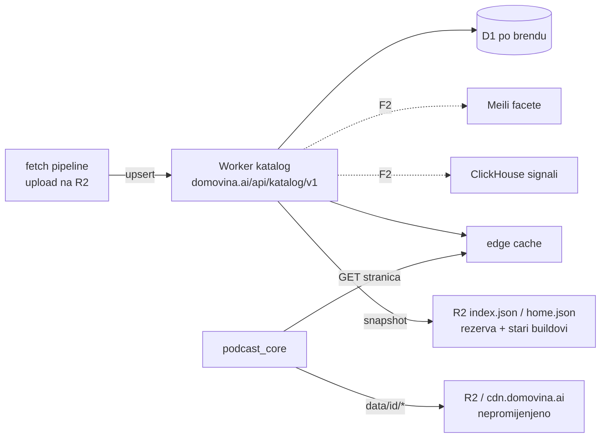

# Plan — katalog kao servis (Worker + D1)

## Zašto ovo postoji

Od 03.11.2026. pipeline obrađuje sve hrvatske (i od 05.11. regionalne) podcaste s
`podcast.domovina.ai`, ~25 epizoda dnevno, od čega ~89 % Tier 2. Tier 2 epizode su na
CDN-u i otvaraju se na `/v/<id>`, ali ih aplikacija ne vidi: `generate_channel_index.js`
preskače mapu `_unlisted`, a klijent katalog gradi tako da skine sve listinge i računa u
memoriji. Zbirne datoteke (`index_bundle.json` 5,6 MB, `search.json` 2,9 MB, samo Tier 1)
rastu linearno s korpusom. Cilj je sloj isporuke kataloga koji jednako brzo radi za 500 i
za 500 000 kanala: aplikacija dobiva samo stranicu koju prikazuje, a filtriranje i
rangiranje rade na serveru.

Brojke iz S0 (05.11.2026.):

| što | vrijednost | naredba |
|---|---|---|
| Tier 2 epizoda na disku | 232 iz 132 kanala | `ls /Volumes/DOMOVINA2TB/fetch_domovina_tv_output/_unlisted/*.info.json \| wc -l` + grupiranje po `channel_id` |
| zbirne datoteke | `index.json` 43,8 kB · `index_bundle.json` 5,59 MB · `search.json` 2,85 MB · `home.json` 28 kB | `ls -la ../fetch.domovina.tv/storage/meta/channels/data/` |
| unosa u registryju | 588 | `python3 -c "import json;print(len(json.load(open('../fetch.domovina.tv/data/podcasts_registry.json'))))"` |

## Arhitektura

- **R2 ostaje** za sve po epizodi. Mijenja se samo zbirni sloj.
- **D1 je projekcija**, ne izvor istine. Izvor je ono što je pipeline stvarno uploadao;
  `drift-check` to mjeri svako jutro.
- **Statični snapshot ostaje**: `index.json` (Tier 1, zamrznut ugovor) za stare native
  buildove koji rade `prefetchAll(index.channels)` i kao rezerva kad API ne odgovori.

## Tvrdi uvjeti (svaka sesija)

1. **Stari buildovi se ne lome.** `channels/data/index.json` i listinzi Tier 1 kanala
   zadržavaju oblik i opseg. Tier 2 kanal NIKAD ne ulazi u `index.json` (stari klijent
   bi pri pokretanju povukao stotine listinga).
2. **`rows_read` po zahtjevu ograničen je veličinom stranice**, ne veličinom kataloga.
   Keyset paginacija, indeks za svaku rutu, `OFFSET` zabranjen. Test to provjerava kroz
   `meta.rows_read`.
3. **Aplikacija radi i bez servisa.** Brend bez `Endpoints.catalog` (ili API koji ne
   odgovori) pada na današnji statični put. Podcasterium tripwire mora ostati zelen.

## Plan po sesijama

| # | Faza | Paket | Odluke | Gotovo kad |
|---|---|---|---|---|
| S1 | F0 | Kostur, migracije, parseri, fixturei | 100 | `npm run check` zelen, `skipped 0`; migracije na lokalnom D1; parseri čitaju sve fixturee |
| S2 | F0 | Uvoznik (Tier 1 + Tier 2) | 200 | uvoz stvarnih podataka u lokalni D1; broj epizoda = broj iz naredbe nad R2 key cacheom; drugi uvoz 0 promjena |
| S3 | F0 | API v1 + ugovor + cache | 300 | ugovorni testovi zeleni; svaka ruta `rows_read` ≤ k × limit stranice (test) |
| S4 | F0 | Sintetička skala + izvještaj; **vrata** | 400 | izvještaj s brojkama i naredbama; korisnik odgovorio na staging |
| S5 | F0 | Staging deploy + latencija; **vrata** | 500 | izvještaj latencije iz HR; korisnik odlučio go/no-go |
| S6 | F1 | Produkcija, ingest, drift-check | 600 | `drift-check` exit 0 na produkciji; launchd job učitan |
| S7 | F1 | Pipeline producer (**u `fetch.domovina.tv`**) | 700 | nova epizoda iz nightlyja u D1 bez ručnog uvoza; `episode.json` nosi `channel` |
| S8 | F1 | `CatalogClient`, ekran epizode | 800 | `flutter test` zelen; Tier 2 epizoda ima kanal bez `findVideoAsync`; Podcasterium tripwire zelen |
| S9 | F1 | „Danas u korpusu” + `/dani/:datum` | 900 | widget testovi; `node scripts/test-social-tags.mjs` pokriva `/dani/` |
| S10 | F1 | `/channels` „Svi” + Tier 2 `/c/:slug` | 1000 | testovi; OG za Tier 2 kanal |
| S11 | F1 | Release; **vrata** | 1100 | produkcija servira novu verziju (`curl … grep 'DOMOVINA v'`); nightly build prošao |
| S12 | F2 | `/home` na serveru; **vrata** (hero) | 1200 | paritet 40/40; `prefetchAll` ugašen uz katalog |
| S13 | F2 | Facete kroz Meili, dizajn rangiranja | 1300 | facetni upiti u testovima; istraživački dokument za rangiranje |
| S14 | F3 | Brendovi i shardovi | 1400 | sintetika 500k kanala preko shardova, `rows_read` i dalje ograničen stranicom |

**Procjena:** 14 sesija. **Vrata:** S4 (staging na računu), S5 (go/no-go), S6
(produkcijski deploy), S11 (release), S12 (Tier 2 u heru). **Paralelno:** S9 ‖ S10 nakon
S8 (diraju različite ekrane; `app_router.dart` dijele, pa rute dodaje S9, a S10 ga ne
dira); S13 se može raditi uz S12 ako se ne dira `home`. **Najrizičniji:**

- **S2**: preslikavanje `channel_id` → registry slug. Nije izmjereno koliko Tier 2 epizoda
  nema razriješen kanal; to se mjeri u S2.
- **S4/S5**: pretpostavka da D1 + edge cache nije sporiji od statičnog `home.json`. Ako
  latencija padne, F1 se mijenja (npr. snapshot iz D1 na R2 kao primarni put).
- **S12**: hero logika je puna izmjerenih zamki (latch, skeleton visina); paritetni test
  je uvjet.

Trošak: nema LLM poziva. Cloudflare: D1 se naplaćuje po pročitanim i zapisanim retcima;
procjena po ruti izlazi iz S4, ne iz pretpostavke.

## Gdje smo

S0: plan, TODO i handoffi. S1 (05.11.2026., `ac07618`): kostur Workera (`/health`), D1 shema s
keyset indeksima, parseri svih ulaza, stvarni fixturei; 134 testa. S2 (`277d704`): uvoznik Tier 1 + Tier 2 u lokalni D1 (3412 + 253 epizode, 162 kanala, 22 Tier 2 epizode bez kanala zbog registryja), idempotentan; 174 testa. Sljedeće: S3, API v1.
