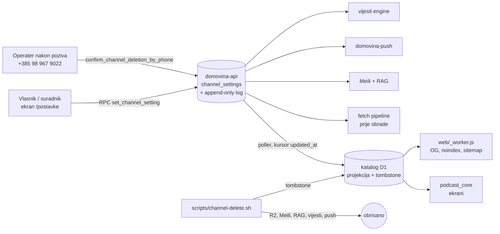

# Plan — postavke kanala za vlasnika

## Zašto ovo postoji

Vlasnik YouTube kanala koji je na domovina.ai dokazao vlasništvo (`youtube-claim`, tablica
`domovina_ai.channel_claims`) danas može samo upravljati novčanikom i kampanjama. Ne može
odlučiti što domovina.ai radi s njegovim sadržajem. Cilj je da vlasnik i njegovi suradnici
jednim ekranom uključe ili isključe svaku funkcionalnost nad kanalom, ili cijeli kanal, da
se svaka promjena trajno i kronološki bilježi, i da trajno brisanje kanala postoji kao
postupak (potvrda u aplikaciji + telefonski poziv), nakon kojeg u katalogu ostaje samo
zapis trenutka brisanja.

## Arhitektura

- **Izvor istine je domovina-api** (Supabase, `domovina_ai` shema): pisanje traži
  korisnika i provjeru vlasništva, pa po pravilu „Backend placement” ide u Postgres + RPC,
  ne u Worker.
- **Katalog D1 je projekcija** za čitanje (aplikacija ga već čita). Kasni najviše jedan
  ciklus pollera; točnu brojku mjeri S3.
- Pozadinski potrošači (pipeline, Meili, RAG, push, vijesti) čitaju ili domovina-api
  (javni pogled stanja) ili katalog; svaki izbor je odluka paketa koji ga uvodi.

## Tvrdi uvjeti (vrijede u svakoj sesiji)

1. **Sakriti ≠ obrisati.** Prekidač je reverzibilan i ne briše datoteke. Jedino trajno
   brisanje cijelog kanala briše, i to samo kroz skriptu brisanja `channel-delete.sh` (nastaje u S9) nakon
   potvrđenog poziva.
2. **Log je append-only.** Nijedna uloga (ni `service_role` kroz RPC) ne mijenja ni ne briše
   događaj. Ispravak je novi događaj.
3. **Povučen kanal nije 404.** `/c/<slug>`, `/v/<id>` i OG za njih kažu da je vlasnik
   povukao sadržaj, uz poveznicu na YouTube; obrisan kanal kaže datum brisanja.
4. **Zadano je uključeno.** Kanal bez retka postavki i nepoznat ključ = uključeno, tako da
   stari buildovi i kanali bez vlasnika rade kao danas.
5. **Tombstone je trajan.** Ne briše ga ni skripta brisanja ni rekoncilijator; UC s
   tombstoneom pipeline nikad ponovno ne obrađuje.

## Sesije

| # | Faza | Paket | Odluke | Gotovo kad |
|---|---|---|---|---|
| S1 | F0 | Mjerenje: UC pokrivenost, produkcijski claim, matrica provedbe, popis brisanja | 100 | research dokument s naredbama za svaku brojku; matrica ima 20 redaka bez praznih ćelija; **vrata** ako claim u produkciji ne radi |
| S2 | F1 | domovina-api: shema, RPC, RLS (lokalno) | 200 | lokalna migracija prolazi na čistoj bazi; SQL testovi zeleni (uključujući: suradnik piše, istekla verifikacija ne piše, UPDATE loga pada); **vrata: produkcijska migracija** |
| S3 | F2 | katalog: projekcija, poller, API stanja, drift-check | 300 | `cd katalog && npm run check` zelen, `skipped 0`; test: master off → kanal izostaje iz `/channels`, `/home`, `/dani`; `/channels/:slug` vraća `withdrawn`/`deleted`; **vrata: deploy** |
| S4 | F3 | Flutter: servis, ekran postavki, log, zahtjev za brisanje | 400 | `flutter test` prema baselineu; widget test ekrana (20 prekidača, log redom od najnovijeg, brisanje traži upis imena kanala i prikazuje telefon); `flutter analyze` čist |
| S5 | F3 | Flutter: provedba na ekranima + povučen/obrisan prikaz | 500 | test po prekidaču koji se vidi u aplikaciji (popis iz matrice S1); test da kanal bez postavki izgleda kao danas |
| S6 | F3 | Worker: OG, noindex, sitemap | 600 | `node scripts/test-social-tags.mjs` + novi slučajevi za povučen i obrisan kanal zeleni |
| S7 | F4 | Pipeline (iz `fetch.domovina.tv`) | 700 | test u fetch repou: isključena obrada → epizoda preskočena; tombstone UC → otkrivanje ga odbija |
| S8 | F4 | Meili, RAG, push; ugovor za vijesti | 800 | test po repou; dokument ugovora za vijesti predan lancu vijesti (**vrata/dogovor**) |
| S9 | F5 | `channel-delete.sh` + proba na sintetičkom kanalu | 900 | `--dry-run` nad stvarnim kanalom ispisuje brojeve iz popisa S1; `--execute` nad testnim kanalom ostavi 0 objekata i tombstone; **vrata: prvo stvarno brisanje je uvijek korisnikovo** |
| S10 | F5 | Pravni tekstovi + release | 1000 | web verzija na produkciji (`Production`, `main`); nightly smoke `result=pass`; **vrata: release** |

Procjena: 10 sesija. Vrata: S1 (uvjetno), S2, S3, S8, S9, S10.
Paralelno: S6 ‖ S7 (ne dijele datoteke, S7 je u drugom repou); S8 može ići uz S5.
Najrizičnije:
- **S1**: ako `youtube-claim` u produkciji ne radi (Google verifikacija `youtube.readonly`
  za `domovina-creators`, vidi `docs/channel-ownership-and-safe-payout-plan.md`), ekran
  nema korisnika; tada je prvi posao verifikacija, ne ovaj lanac.
- **S5**: najviše pozivnih mjesta (tri površine playera, oba prikaza epizode, TV).
- **S9**: nepovratno; zato samo sintetički kanal dok korisnik ne kaže drukčije.

## Gdje smo

S0: plan, TODO i handoffi. Koda nema.

S1 (11. 11.): mjerenje gotovo; matrica pokazuje da aplikacija naslovnicu i pretragu čita s CDN-a, ne iz kataloga (odluka 105), pa S3 dobiva `GET /v1/settings` i poller. **Vrata**: u produkciji nema nijednog verificiranog vlasnika (odluka 103); lanac čeka korisnikov izbor na vrhu `handoffs/S2.md`.
