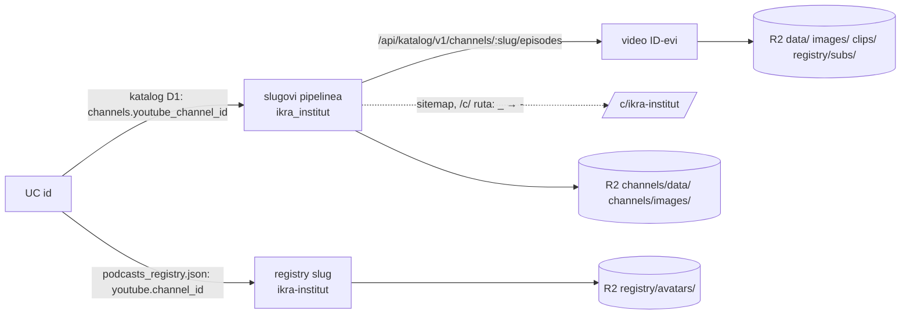

# Popis trajnog brisanja kanala (S1, ulaz za S9)

Mjereno 11. 11. 2026., samo čitanjem: R2 `ListObjectsV2`, Meili search-only ključevi,
`SELECT` u `BEGIN READ ONLY` transakcijama, ClickHouse `--readonly=1`, `wrangler d1 execute`
sa `SELECT` i `wrangler kv key list`. Ništa nije obrisano, upisano, purgeano ni uploadano.
Skripte su u dodatku A (izvorno u scratchpadu sesije, `brisanje/`).

## Zaključak

- **Mjerni kanal: `ikra_institut`** (Ikra - Institut za kulturu mišljenja), UC
  `UCzRilkVJ-f4VvzoPDojFRYQ`, Tier 1, **27 epizoda**, jedini slug s tim UC-om, registry slug
  `ikra-institut`. Katalog, R2, disk, RAG i Meili se slažu na 27 ID-eva.
- **R2: 1 385 objekata, 2,07 GB** (1 382 po epizodi + 3 po kanalu). Najviše su screenshotovi
  (502) i OG slike po sekciji (475); 78 % bajtova je `video_h264.mp4`.
- **CF purge: 2 776 unosa = 93 poziva** (1 385 ključeva + 3 zbirne datoteke, svaki u dvije
  `Vary: Origin` varijante, 30 unosa po pozivu).
- **Meili (cloud): 475 dokumenata u `episodes`, 6 065 u `segments`.** Lokalni Meili na Mac
  miniju ima iste podatke i iz njega se cloud puni.
- **RAG cloud:** ClickHouse `rag_chunks` 1 062, `mv_channel_daily` 8; Postgres
  `person_mentions` 431 (382 osobe), `speakers` 37 (27 samo s ovim kanalom). **Lokalni RAG**
  (izvor noćnog synca) ima iste brojke plus `channels` 1, `episodes` 27, `episode_mentions` 431.
- **domovina-api:** jedino `watch_progress` (6 redaka, 6 korisnika). Claim, pinka, glasanje,
  vijesti, Storage: 0. Analitika: 10 događaja s `video_id` kanala, 2 s rutom `/c/`.
- **Katalog D1:** 1 kanal + 27 epizoda za brisanje (tombstone se dodaje, ne briše).
- **Push:** 0 ključeva `sent:<id>` u KV-u (TTL 30 dana); FCM tema `ep_c_ikra_institut` se ne
  može ni prebrojiti ni obrisati.
- **Lokalni disk:** 1 744 datoteke, 3,5 GB na `DOMOVINA2TB`; 4 datoteke liste/stanja u
  `automatic/podcasts/`, 4 meta datoteke.
- **Spremišta koja plan (odluka 5) nije naveo:** lokalni RAG + lokalni Meili (izvor koji bi
  sutradan vratio obrisano), RAG `speakers` s glasovnim embeddingom, `registry/avatars/` i
  `registry/subs/` na R2, `clips/<id>/` na R2, `watch_progress` u domovina-api (kopija naslova i
  thumbnaila), ClickHouse analitika, `automatic/watchlist/*.json`, registry i onboarding liste,
  R2 bucket `domovina-rag-snapshots`, legacy GCS/Vertex AI Search, D1 Time Travel.
- **Ne briše se (zakon / svrha):** financijski zapisi pinka (`contributions`, `payouts`,
  `campaigns`, `slots`), `episode_safes`/`safe_actions` i on-chain podaci, log postavki i zahtjev
  za brisanje (dokaz pristanka), tombstone, `person_optouts`.

## Kako od UC id-a do popisa



1. **UC → slugovi:** `SELECT slug FROM channels WHERE youtube_channel_id = ?` u katalogu
   (`katalog_count.sh`) ili filtar nad `/api/katalog/v1/channels?limit=100` uz paginaciju
   `?cursor=<next>` (`list_channels.sh`; 186 kanala, 2 stranice). Jedan UC dijele slugovi
   playlista (izmjereno: 1 UC sa više slugova), pa skripta mora ići po svim slugovima.
2. **Slug → ID-evi:** `/api/katalog/v1/channels/<slug>/episodes?limit=100` (+ `next`). Taj popis
   izostavlja retke s `variant_of` (indeks `episodes_by_channel` u
   `katalog/migrations/0003_episodes_variant_of.sql`), pa S9 treba čitati D1 izravno ili
   provjeriti `variant_of` (za ikra: 0). Ad-hoc epizode istog UC-a u `_unlisted` imaju drugi
   slug; za ikra 0 (`disk_count.sh`).
3. **Registry slug** nije slug pipelinea (`ikra-institut` ↔ `ikra_institut`) i nalazi se samo
   preko UC-a u `data/podcasts_registry.json`. Sitemap i `/c/` koriste slug s crticama.

## Tablica spremišta

| # | spremište | ključ po epizodi | ključ po kanalu | ikra_institut | radnja |
|---|---|---|---|---|---|
| 1 | R2 `cdn-domovina-ai` | `data/<id>/`, `images/<id>/`, `clips/<id>/`, `registry/subs/<id>.<lang>.srt` | `channels/data/<slug>.json`, `channels/images/<slug>/`, `registry/avatars/<regslug>.jpg` | 1 385 obj., 2 120,5 MB | brisati |
| 2 | R2 zbirne datoteke | ID u `index_bundle.json`, `search.json` | slug u `index.json`, `index_bundle.json` | 3 datoteke | prepisati (regenerirati bez kanala) |
| 3 | Cloudflare cache | svaki R2 ključ × 2 varijante | isto | 2 776 unosa, 93 poziva | purge |
| 4 | Worker `domovina.ai` | `/v/<id>` OG (cacheTtl 300 s) | `/sitemap.xml` (Cache API 1 h), `/c/<slug>` | 27 ID-eva + 1 `/c/` u sitemapu | isteče samo; sitemap čita katalog |
| 5 | Meili cloud `search.domovina.ai` | `youtube_id` | filtar `channel = '<slug>'` | `episodes` 475, `segments` 6 065 | delete by filter |
| 6 | Meili lokalni (Mac mini) | isto | isto | `episodes` 475, `segments` ≥ 1 000 | delete by filter (prije clouda) |
| 7 | RAG ClickHouse cloud | `rag_chunks.youtube_id` | `rag_chunks.channel`, `mv_channel_daily.channel` | 1 062 + 8 | `ALTER TABLE … DELETE` |
| 8 | RAG Postgres cloud | `person_mentions.youtube_id`, `person_channel_overrides.youtube_id` | `speakers.channels` (jsonb) | 431; 0; 37 (27 samo ovaj kanal) | brisati; speakers vidi niže |
| 9 | RAG lokalni (PG + CH) | isto + `episodes.youtube_id`, `episode_mentions` | `channels.slug` | 1 + 27 + 431 + 1 062 + 431 + 37 | brisati (inače ga `sync-cron.sh` vrati) |
| 10 | vijesti (domovina-api `vijesti.*`, lokalni PGlite, `.cache/cdn`) | `moments.video_id`, `runs.video_id`, `eval_sample.video_id` | `allowed_channels.channel`, `eval_channels.channel` | 0 svugdje | brisati momente; objavljeni članak = ispravak |
| 11 | push | KV `sent:<videoId>` | FCM tema `ep_c_<slug>` | 0 KV; tema nemjerljiva | KV pustiti da istekne; tema nestaje kad je klijenti napuste |
| 12 | katalog D1 | `episodes.id` | `channels` (UC) | 1 + 27 | brisati retke, upisati tombstone |
| 13 | domovina-api `domovina_ai` | `favorites`, `watch_progress`, `watch_sessions`, `safe_actions` | `channel_claims`, `oauth_states`, `episode_safes`, `vote_*` | `watch_progress` 6, ostalo 0 | po tablici, vidi niže |
| 14 | domovina-api `pinka_finance` | `slots.youtube_id` | `campaigns.youtube_channel_id`, `campaign_subjects.subject_ref` | 0 | **zadržati** (zakon) |
| 15 | domovina-api Storage | ime objekta | ime objekta | 0 (bucketi `pinka-covers`, `pinka-og-cache`, `sponsor-logos`) | brisati ako postoji |
| 16 | analitika ClickHouse | `events.video_id` | `events.channel`, `events.route` | 10 (2 uređaja); 0; 2 | otvoreno (TTL 25 mj.) |
| 17 | fetch repo: registry i liste | `automatic/watchlist/backfill.json`, `subs-state.json` | `data/podcasts_registry.json`, `automatic/podcasts/<regslug>-*`, `automatic/refresh_podcasts.sh` | 27 + 6 ID-eva; 1 zapis; 4 datoteke; 1 redak | registry → oznaka brisanja, ne uklanjanje |
| 18 | fetch lokalni disk | `<datum>_<naslov>_yt_<id>.*` | `storage/output/<slug>` → `DOMOVINA2TB`, `storage/meta/channels/{data,images}/<slug>*` | 1 744 dat., 3,5 GB; 4 meta | brisati |
| 19 | `domovina-rag-snapshots` (R2) | — | backup CH/PG | nemjerljivo (AccessDenied) | otvoreno |
| 20 | legacy GCS + Vertex AI Search | `*.rag_combined.jsonl` | prefiks | nemjerljivo (GCS nedostupan) | otvoreno |

## 1. R2 i CDN

Bucket `cdn-domovina-ai` (`R2_BUCKET_NAME` u `fetch.domovina.tv/.env`, javno kao
`cdn.domovina.ai`). Vršni prefiksi (`r2_top.js`): `channels/ clips/ data/ images/ mediakit/
registry/`. Ključeve aplikacije slaže `getFlutterKey()` u `fetch.domovina.tv/upload_to_r2.js`;
sirovi pipeline ključevi (`<kanal>/<videoBase>…`) se više ne uploadaju i na R2 ih nema (nema
vršnog prefiksa po kanalu).

**Po epizodi** (izmjereno na ikra; `r2_count.js`, razrada po imenu datoteke u dodatku):

| ključ | ikra | izvor |
|---|---|---|
| `data/<id>/info.json`, `summary.json`, `article.json`, `outline.json`, `diarized.srt`, `episode.json`, `sponsors_in_video.json` | 27 × 7 = 189 | `upload_to_r2.js`, `build_episode_bundle.js`, `tools/upload_sponsors_in_video.js` |
| `data/<id>/video_h264.mp4` | 27 (1 652,1 MB) | KORAK 12.5 |
| `data/<id>/book.epub` | 27 (33,3 MB) | `generate_ebook.js` |
| `images/<id>/thumbnail.png`, `thumb-{320,640,1280}.webp`, `og-share.jpg`, `og-sections.json` | 27 × 6 = 162 | `upload_to_r2.js`, `upload_og_share_fast.js` |
| `images/<id>/og-t-<sec>.jpg` | 475 (45,8 MB) | `generate_og_sections.py` |
| `images/<id>/screenshots/<HH-MM-SS>.png` + `manifest.json` | 475 + 27 (354,6 MB) | screenshot korak |

Ključevi koji postoje u katalogu općenito, a ikra ih nema (skripta ih mora pokriti jer briše
cijeli prefiks): `video.mp4`, `video_h264_fmp4.mp4`, `video_h264_fmp4_web.mp4`, `audio.mp3`,
`summary.en.json`, `article.en.json`, `article.magisterium*.json` i `*_prompt.md`,
`diarized.en.srt`, `words.json`, `words.en.json`, `book.en.epub`, `reels.json`,
`reels.en.json`, `reels/<rank>-<v>.{mp4,poster.webp,storyboard.jpg}` (`render_reels.js`),
`screenshots_webp.json`, `images/<id>/screenshots/<ts>-960.webp`, `og-t-<sec>-en.jpg`,
`clips/<id>/…` (16 epizoda u bucketu ima isječke), `registry/subs/<id>.<lang>.srt`
(`automatic/fetch_youtube_subs.js`, 97 datoteka u bucketu).

**Po kanalu:** `channels/data/<slug>.json` (1), `channels/images/<slug>/avatar_{square,cover}.jpg`
(2), `registry/avatars/<registry-slug>.jpg` (`sync_voting_candidates.mjs`, `AVATAR_PREFIX`;
ikra 0, u bucketu 411).

**Naredba (dry):**

```bash
cd <scratchpad>/brisanje
node r2_count.js ikra_institut ikra-institut ikra_ids.txt
```

Izlaz (85 `ListObjectsV2` poziva):

```
     1        0.1 MB  channels/data/<slug>*.json
     2        0.2 MB  channels/images/<slug>/
   189       24.7 MB  data/<id>/ JSON/SRT/MD
    27     1652.1 MB  data/<id>/*.mp4 (video, h264, fmp4, fmp4_web)
    27       33.3 MB  data/<id>/book*.epub
   162        9.8 MB  images/<id>/ ostalo (thumbnail, thumb-*.webp, og-share, og-sections.json)
   475       45.8 MB  images/<id>/og-t-*.jpg
   502      354.6 MB  images/<id>/screenshots/*.png|json
  1385     2120.5 MB  UKUPNO
po epizodi: min 26 medijan 46 max 120; epizoda bez ijednog objekta: 0
```

Brisanje treba ići **listanjem prefiksa**, ne popisom iz `episode.json`: `episode.json` ne
navodi screenshotove ni OG slike (i sam je jedan od ključeva koji se briše).

### Zbirne datoteke (prepisati, ne brisati)

`aggregates.sh` (5 HTTP zahtjeva):

| datoteka | spominje | radnja |
|---|---|---|
| `channels/data/index.json` | slug 3×, UC 1×, 1 ID | regenerirati `generate_channel_index.js` bez kanala |
| `channels/data/index_bundle.json` | slug 3×, UC 1×, 27/27 ID | isto |
| `channels/data/search.json` | 27/27 ID | isto |
| `channels/data/home.json` | 0 (bazen svježih epizoda) | regenerirati samo ako ga spominje |
| `https://domovina.ai/sitemap.xml` | `/c/ikra-institut` 1×, 27 `/v/<id>` | worker ga gradi iz kataloga; nestaje kad nestanu retci u D1, Cache API 1 h |
| `fetch…/automatic/watchlist/backfill.json` | 27 ID (izvor dana objave za katalog) | maknuti ID-eve, inače ih katalog može ponovno uvesti |

`generate_channel_index.js` gradi indekse iz diska (`storage/output`), pa redoslijed u S9 mora
biti: obrisati disk → regenerirati indekse → upload `--meta-dir` → purge.

### Purge

R2 odgovara s `Vary: Origin`, pa svaki URL ima dva cache zapisa (korijenski `CLAUDE.md`,
„Cachiran 404” i pravilo o purgeu). `purgeCloudflareCache()` u `upload_to_r2.js` već šalje oba
oblika (`u` i `{url: u, headers: {Origin: "https://domovina.ai"}}`) u serijama po 30.

- 1 385 obrisanih ključeva × 2 = 2 770
- 3 prepisane zbirne datoteke × 2 = 6 (`channels/` je ionako `max-age=60`)
- **ukupno 2 776 unosa = ⌈2 776 / 30⌉ = 93 poziva** (`wc -l r2_keys_ikra_institut.txt` = 1 385)

Zona `/data/` CF cache pravila daje pregledniku 3600 s (`fetch.domovina.tv/setup_cdn_cache_rule.sh`);
purge to ne skraćuje u već preuzetim preglednicima.

## 2. Meili

Produkcija: `https://search.domovina.ai` (Coolify, kontejner `meilisearch-ddvxwyfmd2ynx3fyl96p7ltq-*`
na dom-001). Indeksi `episodes` (dokument po sekciji članka, `id = <youtube_id>_<n>`,
`distinctAttribute: youtube_id`) i `segments` (transkript). Oba imaju `channel` (slug pipelinea)
i `youtube_id` kao filtrabilne atribute (`domovina-rag/scripts/meili-poc-index.py`,
`meili-segments-index.py`). Drugih indeksa skripte ne stvaraju.

`meili_count.sh` koristi javne search-only ključeve iz `lib/services/meili_client.dart` i
`lib/services/transcript_search.dart` (ne ispisuje ih). `estimatedTotalHits` je odrezan na 1 000,
pa se `segments` broji po epizodi u page modu (27 zahtjeva):

```
episodes channel=ikra_institut: 475
episodes youtube_id IN (ID-evi kanala): 475
segments po epizodi zbrojeno: 6065 (najviše u jednoj epizodi: 807)
episodes (page mod): 27        # distinct po youtube_id
```

Brisanje: `POST /indexes/{episodes,segments}/documents/delete` s `{"filter": "channel = '<slug>'"}`
master ključem (`MEILI_MASTER_KEY`, preko SSH tunela kao `sync-meili.sh --cloud`).
**Prvo lokalni Meili, pa cloud**: cloud je derivat lokalnog CH-a i puni se punim re-indexom
(`domovina-rag/docs/coolify-meili-application.md`).

## 3. RAG, semantika, osobe (`domovina-rag`)

Produkcija na dom-001, Coolify stack `ddvxwyfmd2ynx3fyl96p7ltq`: Postgres `rag`
(`postgres-ddvxwyfmd2ynx3fyl96p7ltq-*`), ClickHouse `rag` (`clickhouse-ddvxwyfmd2ynx3fyl96p7ltq-*`).
Cloud Postgres ima samo `person_*`, `speakers`, `oauth_*`; `channels`/`episodes` iz
`infra/postgres/init.sql` postoje samo lokalno. MCP (`mcp.domovina.ai`) čita ove tablice.

| tablica | filtar | cloud | lokalno | radnja |
|---|---|---|---|---|
| CH `rag.rag_chunks` (tekst + bge-m3 vektor) | `channel = slug` | 1 062 (27 ep.) | 1 062 | `ALTER TABLE … DELETE WHERE channel = …` |
| CH `rag.mv_channel_daily` (+ `.inner_id…`) | `channel` | 8 | — | isto nad ciljnom tablicom MV-a |
| CH `rag.speaker_voice_signatures` | `episode_id` iz `rag_chunks` | 0 | 0 | brisati po `episode_id` (prije `rag_chunks`) |
| CH `rag.episode_mentions` | `channel` | tablica ne postoji | 431 | brisati |
| PG `person_mentions` | `channel = slug` | 431 (382 osobe) | 431 | brisati |
| PG `person_channel_overrides` | `youtube_id` | 0 | — | brisati |
| PG `speakers` (`channels` jsonb, `voice_embedding_avg`) | `channels ? slug` | 37, od toga 27 samo ovaj kanal | 37 / 27 | 27 brisati (glasovni otisak je biometrijski podatak), 10 maknuti slug iz `channels` |
| PG `person_optouts` | `slug` osobe | — | — | **zadržati** (volja osobe, ne sadržaj kanala) |
| PG lokalno `channels`, `episodes`, `sync_state` | `slug` | — | 1, 27 | brisati |

Naredbe: `rag_pg_count.sh`, `rag_ch_count.sh` (cloud), `rag_local_count.sh` (lokalno).
**Redoslijed:** lokalni CH/PG/Meili pa cloud, i u istom prozoru isključiti kanal iz izvora
(`*.rag_combined.jsonl` na disku), inače `domovina-rag/scripts/sync-cron.sh` (launchd 04:00) sve vrati.
Osobe koje nakon brisanja ostanu bez nastupa ispadaju iz `/p/` profila i virtualnih kanala
(pravilo u `domovina-rag/services/mcp/src/tools/person-channel.ts` se preračuna samo).

## 4. Vijesti (`vijesti/`)

Engine piše u Postgres (`vijesti.*` u domovina-api, produkcija od odluke 801) i lokalno u
PGlite (`vijesti/.cache/vijesti.pglite`, `proba-claude.pglite`, `eval-fake.pglite`) te
`vijesti/.cache/cdn/data/<id>/` (disk cache CDN-a). Veza na kanal je `video_id` u
`moments`, `runs`, `eval_sample`, i `channel` u `allowed_channels`, `eval_channels`. Članci
citiraju kanal preko `article_sources.moment_id` i `story_moments.moment_id`.

Izmjereno (`api_pg_count.sh`): ikra 0 u svim tablicama, 0 u lokalnom cache-u (20 epizoda u
cacheu su drugi kanali). U produkciji je danas 125 momenata iz 1 epizode, `allowed_channels` 3.

Radnja: momente, runove i eval uzorke brisati; **objavljen članak** koji citira moment kanala
ne briše se tiho nego ide kroz `vijesti.corrections` (ispravak s razlogom) ili povlačenje.
Ugovor o tome dogovara S8 s lancem vijesti.

## 5. Push (`domovina-push`)

Worker bez baze: KV `STATE` (`a2bcc79eddb04ff8b78520b9fbad7717`) drži `sent:<videoId>` s TTL-om
30 dana i `seeded`; R2 binding čita listinge kanala. Tema kanala je `ep_c_<slug>`
(`domovina-push/src/select.ts` ↔ `lib/services/push_topics.dart`). Pretplate su samo na
uređaju (`push_topics_v1`); FCM nema API za popis pretplatnika teme ni brisanje teme.

`push_count.sh`: `KV sent:* ukupno 89, od toga epizode kanala: 0`.

Radnja: ništa za brisati na serveru. Kad listing kanala nestane s R2, Worker za kanal više ne
šalje. Klijent u `reconcile` mora odjaviti temu kanala koji je povučen ili obrisan (posao S8);
inače tema ostaje do reinstalacije, bez štete jer na nju nitko ne šalje.

## 6. Katalog D1

Baza `katalog` (`a841df13-…`), račun D.O.M. (isti `account_id` kao `domovina-push/wrangler.jsonc`;
bez `CLOUDFLARE_ACCOUNT_ID` wrangler odbija jer token vidi 16 računa).

`katalog_count.sh`:

```
channels: 1
episodes (svi slugovi s tim UC): 27
episodes od toga variant_of: 0
episodes od toga tier 2: 0
```

Radnja: obrisati `episodes` i `channels` retke, upisati tombstone (tablica iz S3, odluka 6).
`ingest_runs.counts` nema ID-eva. D1 Time Travel čuva povijest 30 dana: obrisani retci su
toliko dugo obnovljivi, što treba spomenuti u pravnom tekstu (S10). Izvor kataloga
(`backfill.json`, listinzi na R2, drift-check) mora biti počišćen prije, inače ingest vrati retke.

## 7. domovina-api Postgres

`supabase-db-cv887vonujh1swebndh4x4iu` na dom-001; `api_pg_count.sh` broji samo agregate.

| tablica | veza | ikra | radnja | razlog |
|---|---|---|---|---|
| `domovina_ai.channel_claims` | UC | 0 (ukupno 5) | zadržati do kraja postupka, zatim status `revoked` bez brisanja retka koji dokazuje tko je tražio brisanje | dokaz ovlaštenja za nepovratnu radnju; odluka za S9 |
| `domovina_ai.oauth_states` | UC | 0 | brisati | prolazni OAuth state |
| `domovina_ai.episode_safes`, `safe_actions`, `owner_wallets` | UC / `episode_id` | 0 | **zadržati** | novčani tok i on-chain adrese; lanac se ionako ne briše |
| `domovina_ai.favorites` | `episode_id` | 0 | brisati | upućuje na sadržaj kojeg više nema |
| `domovina_ai.watch_progress` | `episode_id`, `channel_id` (većinom UC: 1 569 od 1 632) | **6 redaka, 6 korisnika** | brisati | redak nosi kopiju naslova i URL thumbnaila kanala |
| `domovina_ai.watch_sessions` | `episode_id` | 0 | brisati | isto |
| `domovina_ai.onboarding_events` | ID u `properties` | 0 | zadržati | događaj korisnika, ID nije sadržaj |
| `domovina_ai.vote_candidates` | UC / registry slug | 0 (401 od 413 ima UC) | status `withdrawn`, ne brisati | rekoncilijator iz registra bi ga vratio (pravilo „onboardan ≠ povučen”) |
| `domovina_ai.votes`, `vote_tallies`, `vote_rounds`, `candidate_follows` | registry slug | 0 | zadržati | rezultati krugova su povijest korisnika |
| `pinka_finance.campaigns`, `campaign_subjects`, `contributions`, `subscriptions`, `payouts` | UC / `subject_ref` | 0 (2 kampanje s UC u bazi) | **zadržati**, kampanja `deleted_at` + `visibility` skrivena | Zakon o računovodstvu (knjigovodstvene isprave 11 godina), GDPR čl. 17(3)(b) |
| `pinka_finance.slots` (`youtube_id`, sponzorski trenuci) | `youtube_id` | 0 | **zadržati** zapis, ugasiti prikaz (`live_until`) | plaćena usluga, račun |
| `vijesti.*` | vidi §4 | 0 | vidi §4 | |
| `storage.objects` | ime | 0 | brisati ako postoji | |
| log postavki i zahtjev za brisanje (S2) | UC | još ne postoji | **zadržati** | dokaz pristanka i potvrde poziva (odluka 4, 5) |

Analitika (`domovina-analytics`, ClickHouse `analytics.events`, `analytics_count.sh`):
10 događaja s `video_id` kanala (2 uređaja), 0 s `channel`, 2 s rutom `/c/`, od 29 437 ukupno.
Događaji su pseudonimni i imaju TTL 25 mjeseci (`clickhouse/sql/003_retention.sql`).
Preporuka: zadržati (mjerenje rada aplikacije, ne sadržaj kanala); ako se odluči brisati, to je
mutacija `ALTER TABLE analytics.events DELETE WHERE video_id IN (…)`.

## 8. fetch repo: registry, liste, disk

`registry_count.sh`, `disk_count.sh`:

- `data/podcasts_registry.json`: 1 zapis (`ikra-institut`, `tracking.enabled: true`), plus
  izvedeni `podcasts_registry.csv`, `.md`, `dashboard/public/registry.json`.
- `automatic/refresh_podcasts.sh`: 1 redak (`ikra-institut|https://www.youtube.com/@ikra-institut/videos`).
- `automatic/podcasts/ikra-institut-{channel.json,lista.txt,lista-state.json,arhiva.txt}`:
  4 datoteke (27 ID-eva, state `archived: 27`); lista, state i arhiva nisu u gitu.
- `automatic/watchlist/backfill.json` 27 ID-eva, `subs-state.json` 6.
- discovery: `data/discovery/runs/2026-09-24/…` 2 datoteke, `data/_raw_research/…` 1 (povijest
  istraživanja, ne ulaz pipelinea).
- disk: `storage/output/ikra_institut` → `/Volumes/DOMOVINA2TB/fetch_domovina_tv_output/ikra_institut`,
  1 744 datoteke, 3,5 GB, 27 `*.info.json`; `_unlisted`, `_legacy`, `_orphan_duplicates`: 0
  s ovim UC-om; `storage/meta/channels/data/ikra_institut.json` + 2 avatara.

**Registry zapis se ne briše nego označava** (npr. `tracking.enabled: false` + oznaka brisanja
koju čita discovery): bez njega Tier 2 discovery i `sync_voting_candidates.mjs` kanal ponovno
pronađu. To je registry strana tombstonea (odluka 6, tvrdi uvjet 5). fetch repo i domovina.ai su
javni: git povijest zadržava registry zapis i ID-eve; to je javni metapodatak YouTubea, ne
sadržaj, i ne prepisuje se povijest.

## Otvorena pitanja za S9

1. **Lokalni izvori prvo.** Lokalni RAG (PG, CH, Meili) i `*.rag_combined.jsonl` na disku moraju
   se obrisati prije clouda, u istom prozoru, ili zaustaviti `sync-cron.sh` dok traje brisanje.
   Isto za `generate_channel_index.js` (disk → zbirni JSON).
2. **`speakers` dijeljeni s drugim kanalima** (10 kod ikra): maknuti slug i preračunati
   `voice_embedding_avg` bez glasova ovog kanala ili ostaviti prosjek? Preračun treba embeddinge
   po epizodi (CH `speaker_voice_signatures`, za ikra 0).
3. **Snapshots i legacy kopije:** `domovina-rag-snapshots` (R2 token fetcha dobiva AccessDenied),
   legacy GCS bucket + Vertex AI Search data store (`import_to_vertex.js`, nije u
   `run_pipeline.sh`), D1 Time Travel 30 dana. Koliki je rok zadržavanja backupa i piše li to u
   politici privatnosti?
4. **`channel_claims` i log:** koji minimum ostaje kao dokaz (tko je zatražio, tko je potvrdio
   poziv)? Tombstone po odluci 6 ne nosi račun; log (odluka 4) je append-only i nosi račun.
5. **Objavljeni članak vijesti** koji citira kanal: ispravak, povlačenje ili ostaje uz uklonjen
   citat? Treba odluku lanca vijesti (S8).
6. **Analitika:** zadržati 10 pseudonimnih događaja do TTL-a ili brisati mutacijom?
7. **FCM tema** se ne može obrisati; je li dovoljna odjava na klijentu kad katalog kaže `deleted`?
8. **`variant_of` epizode** ne vraća javni API popisa epizoda; skripta mora čitati D1 ili
   `index_bundle.json` za potpun popis ID-eva.
9. **Redoslijed i idempotentnost:** R2 brisanje (1 385 `DeleteObject`, ili 2 `DeleteObjects` po
   1 000) prije purgea; purge 93 poziva; ponovni `--dry-run` nakon `--execute` mora dati 0 po
   svakom retku ove tablice osim zadržanih.
10. **Broj poziva po kanalu:** R2 listanje = 3 × epizode + 4; Meili `segments` = 1 po epizodi.
    Najveći kanal u katalogu (`nanovoroeni`, 321 epizoda po `list_channels.sh`) traži ~967
    listanja i 321 Meili upit; listati cijeli `data/` jednom (≈ broj ključeva / 1 000 poziva)
    može biti jeftinije.

## Dodatak A: skripte

Sve skripte su samo za čitanje. Mjereno iz direktorija skripti:
`cd <scratchpad>/brisanje`, s `ikra_ids.txt` (27 ID-eva iz `/api/katalog/v1/channels/ikra_institut/episodes?limit=100`).

```bash
curl -s "https://domovina.ai/api/katalog/v1/channels/ikra_institut/episodes?limit=100" \
  | python3 -c "import sys,json;print('\n'.join(i['id'] for i in json.load(sys.stdin)['items']))" > ikra_ids.txt
bash list_channels.sh
node r2_top.js; node r2_sub.js channels/ clips/ registry/ registry/avatars/ channels/data/
node r2_count.js ikra_institut ikra-institut ikra_ids.txt
bash aggregates.sh ikra_institut UCzRilkVJ-f4VvzoPDojFRYQ ikra_ids.txt
bash meili_count.sh ikra_institut ikra_ids.txt
bash rag_pg_count.sh ikra_institut ikra_ids.txt
bash rag_ch_count.sh ikra_institut ikra_ids.txt
bash rag_local_count.sh ikra_institut
bash api_pg_count.sh ikra_institut UCzRilkVJ-f4VvzoPDojFRYQ ikra_ids.txt ikra-institut
bash analytics_count.sh ikra_institut UCzRilkVJ-f4VvzoPDojFRYQ ikra_ids.txt
bash push_count.sh ikra_institut ikra_ids.txt
bash katalog_count.sh UCzRilkVJ-f4VvzoPDojFRYQ
bash registry_count.sh ikra_institut ikra-institut UCzRilkVJ-f4VvzoPDojFRYQ ikra_ids.txt
bash disk_count.sh ikra_institut UCzRilkVJ-f4VvzoPDojFRYQ
node r2_snapshots.js; bash gcs_count.sh ikra_institut ikra_ids.txt
# razrada R2 ključeva po imenu datoteke
awk -F/ '$1=="data"||$1=="images"{print $1"/"$NF}' r2_keys_ikra_institut.txt \
  | sed -E 's/og-t-[0-9]+(-en)?\.jpg/og-t-N\1.jpg/; s/[0-9]{2}-[0-9]{2}-[0-9]{2}(-960)?\./HH-MM-SS\1./' | sort | uniq -c | sort -rn
```

Ukupno HTTP zahtjeva u mjerenju: oko 200 (R2 ~95 listanja, Meili ~60, CDN/API ~10, ostalo SSH).


### `list_channels.sh`

```bash
#!/bin/bash
# Pobire sve kanale iz javnog katalog API-ja (paginacija ?cursor=), ispisuje Tier 1 s UC i 10-40 epizoda.
set -e
out=channels_all.jsonl; : > $out; cur=""
while :; do
  url="https://domovina.ai/api/katalog/v1/channels?limit=100${cur:+&cursor=$cur}"
  curl -s "$url" -o page.json
  python3 -c "import json;d=json.load(open('page.json'));[print(json.dumps(i,ensure_ascii=False)) for i in d['items']]" >> $out
  cur=$(python3 -c "import json;print(json.load(open('page.json')).get('next') or '')")
  [ -z "$cur" ] && break
done
wc -l < $out
python3 -c "
import json
for l in open('$out'):
  i=json.loads(l)
  if i['tier']==1 and (i.get('youtube_channel_id') or '').startswith('UC') and 10<=i['processed_count']<=40: print(i['slug'],i['youtube_channel_id'],i['processed_count'],i['name'])"
```

### `r2_lib.js`

```js
// Zajedničko: R2 S3 klijent iz fetch.domovina.tv/.env (samo čitanje; vrijednosti se ne ispisuju).
const FETCH = "/Users/ms/git/domovinatv/fetch.domovina.tv";
const fs = require("fs");
for (const line of fs.readFileSync(FETCH + "/.env", "utf8").split("\n")) {
  const m = line.match(/^\s*([A-Z0-9_]+)\s*=\s*(.*)\s*$/);
  if (m && !process.env[m[1]]) process.env[m[1]] = m[2].replace(/^["']|["']$/g, "");
}
const S3 = require(FETCH + "/node_modules/@aws-sdk/client-s3");
const client = new S3.S3Client({ region: "auto",
  endpoint: `https://${process.env.R2_ACCOUNT_ID}.r2.cloudflarestorage.com`,
  credentials: { accessKeyId: process.env.R2_ACCESS_KEY_ID, secretAccessKey: process.env.R2_SECRET_ACCESS_KEY } });
const BUCKET = process.env.R2_BUCKET_NAME || "cdn-domovina-ai";
let calls = 0;
async function list(prefix, delimiter) {
  const out = { keys: [], prefixes: [] }; let token;
  do {
    calls++;
    const r = await client.send(new S3.ListObjectsV2Command({ Bucket: BUCKET, Prefix: prefix, Delimiter: delimiter, ContinuationToken: token }));
    for (const o of r.Contents || []) out.keys.push({ key: o.Key, size: o.Size });
    for (const p of r.CommonPrefixes || []) out.prefixes.push(p.Prefix);
    token = r.IsTruncated ? r.NextContinuationToken : undefined;
  } while (token);
  return out;
}
module.exports = { list, calls: () => calls };
```

### `r2_top.js`

```js
// Vršni prefiksi bucketa (1 ListObjectsV2 s Delimiter "/").
const { list } = require("./r2_lib.js");
(async () => { const r = await list("", "/"); console.log("prefiksi:", r.prefixes.join(" ")); console.log("ključevi u korijenu:", r.keys.length, r.keys.slice(0,20).map(k=>k.key).join(" ")); })();
```

### `r2_sub.js`

```js
// Drugi nivo za zadane prefikse (Delimiter "/"), samo brojevi + primjeri.
const { list } = require("./r2_lib.js");
(async () => { for (const p of process.argv.slice(2)) { const r = await list(p, "/");
  console.log(p, "podprefiksa:", r.prefixes.length, "ključeva:", r.keys.length, "| npr.", r.prefixes.slice(0,8).join(" "), r.keys.slice(0,8).map(k=>k.key).join(" ")); } })();
```

### `r2_count.js`

```js
// DRY: broji R2 objekte kanala. node r2_count.js <slug> <registry-slug> <ids.txt>
// Per epizoda: data/<id>/, images/<id>/, clips/<id>/, registry/subs/<id>.*
// Per kanal: channels/data/<slug>*, channels/images/<slug>/, registry/avatars/<registry-slug>.jpg
const fs = require("fs"); const { list, calls } = require("./r2_lib.js");
const [slug, regSlug, idsFile] = process.argv.slice(2);
const ids = fs.readFileSync(idsFile, "utf8").split("\n").filter(Boolean);
const cat = {}; const add = (c, k) => { cat[c] ??= { n: 0, b: 0 }; cat[c].n++; cat[c].b += k.size; };
function kind(key) {
  const b = key.split("/").pop();
  if (key.includes("/reels/")) return "data/<id>/reels/* (render 9:16, poster, storyboard)";
  if (/\.mp4$/.test(b)) return "data/<id>/*.mp4 (video, h264, fmp4, fmp4_web)";
  if (/\.(mp3|m4a|opus)$/.test(b)) return "data/<id>/audio";
  if (/\.epub$/.test(b)) return "data/<id>/book*.epub";
  if (key.startsWith("data/")) return "data/<id>/ JSON/SRT/MD";
  if (key.includes("/screenshots/")) return /\.webp$/.test(b) ? "images/<id>/screenshots/*.webp" : "images/<id>/screenshots/*.png|json";
  if (/^og-t-/.test(b)) return "images/<id>/og-t-*.jpg";
  if (key.startsWith("images/")) return "images/<id>/ ostalo (thumbnail, thumb-*.webp, og-share, og-sections.json)";
  if (key.startsWith("clips/")) return "clips/<id>/";
  return "?";
}
(async () => {
  const urls = [];
  let perEp = [];
  for (const id of ids) {
    let n = 0;
    for (const p of [`data/${id}/`, `images/${id}/`, `clips/${id}/`]) {
      const r = await list(p); for (const k of r.keys) { add(kind(k.key), k); urls.push(k.key); n++; }
    }
    perEp.push(n);
  }
  const subs = (await list("registry/subs/")).keys.filter(k => ids.some(id => k.key.startsWith(`registry/subs/${id}.`)));
  for (const k of subs) { add("registry/subs/<id>.<lang>.srt", k); urls.push(k.key); }
  const chData = (await list(`channels/data/${slug}`)).keys; for (const k of chData) { add("channels/data/<slug>*.json", k); urls.push(k.key); }
  const chImg = (await list(`channels/images/${slug}/`)).keys; for (const k of chImg) { add("channels/images/<slug>/", k); urls.push(k.key); }
  const av = (await list(`registry/avatars/${regSlug}.`)).keys; for (const k of av) { add("registry/avatars/<registry-slug>.jpg", k); urls.push(k.key); }
  let tn = 0, tb = 0;
  for (const [c, v] of Object.entries(cat).sort()) { console.log(`${String(v.n).padStart(6)}  ${(v.b/1048576).toFixed(1).padStart(9)} MB  ${c}`); tn += v.n; tb += v.b; }
  console.log(`${String(tn).padStart(6)}  ${(tb/1048576).toFixed(1).padStart(9)} MB  UKUPNO`);
  perEp.sort((a,b)=>a-b); console.log(`po epizodi: min ${perEp[0]} medijan ${perEp[perEp.length>>1]} max ${perEp.at(-1)}; epizoda bez ijednog objekta: ${perEp.filter(x=>x===0).length}`);
  console.log(`ListObjectsV2 poziva: ${calls()}`);
  fs.writeFileSync(`r2_keys_${slug}.txt`, urls.join("\n") + "\n");
})();
```

### `aggregates.sh`

```bash
#!/bin/bash
# Zbirne datoteke koje SPOMINJU kanal (prepisati, ne brisati): broj pojavljivanja sluga/UC/ID-eva.
SLUG=$1; UC=$2; IDS=$3
for f in home.json index.json index_bundle.json search.json; do
  curl -s "https://cdn.domovina.ai/channels/data/$f" -o agg_$f
  python3 - "$f" "$SLUG" "$UC" "$IDS" <<'PY'
import sys,json
f,slug,uc,idsf=sys.argv[1:]; t=open('agg_'+f).read(); ids=[l.strip() for l in open(idsf) if l.strip()]
print(f"{f:20s} slug:{t.count(slug):4d}  UC:{t.count(uc):3d}  ID-eva prisutnih:{sum(1 for i in ids if i in t):3d}/{len(ids)}")
PY
done
curl -s https://domovina.ai/sitemap.xml -o agg_sitemap.xml
echo "sitemap.xml: /c/<slug ili slug-s-crticama> $(grep -cE "/c/($SLUG|${SLUG//_/-})<" agg_sitemap.xml), ID-eva $(grep -oFf $IDS agg_sitemap.xml | sort -u | wc -l | tr -d ' ')"
BF=/Users/ms/git/domovinatv/fetch.domovina.tv/automatic/watchlist/backfill.json
echo "backfill.json: ID-eva $(grep -oFf $IDS $BF | sort -u | wc -l | tr -d ' '), UC $(grep -c $UC $BF)"
```

### `meili_count.sh`

```bash
#!/bin/bash
# DRY: broj Meili dokumenata kanala u indeksima episodes i segments (javni search-only ključevi
# iz podcast_core bundlea; ništa se ne ispisuje osim brojki). Filtar: channel = <slug>.
SLUG=$1; IDS=$2; P=/Users/ms/git/domovinatv/domovina.ai/packages/podcast_core/lib/services
KE=$(grep -A2 "'MEILI_SEARCH_KEY'" $P/meili_client.dart | grep -oE "'[A-Za-z0-9]{20,}'" | tr -d "'")
KS=$(grep -A2 "'MEILI_SEGMENTS_SEARCH_KEY'" $P/transcript_search.dart | grep -oE "'[A-Za-z0-9]{20,}'" | tr -d "'")
U=https://search.domovina.ai
q() { curl -s -X POST "$U/indexes/$1/search" -H "Authorization: Bearer $2" -H 'Content-Type: application/json' -d "$3"; }
for pair in "episodes:$KE" "segments:$KS"; do
  idx=${pair%%:*}; k=${pair#*:}
  echo "$idx channel=$SLUG: $(q $idx $k "{\"q\":\"\",\"limit\":0,\"filter\":\"channel = '$SLUG'\"}" | python3 -c 'import sys,json;d=json.load(sys.stdin);print(d.get("estimatedTotalHits",d.get("totalHits",d)))')"
  ids=$(python3 -c "import sys;print(','.join(repr(l.strip()) for l in open('$IDS') if l.strip()))")
  echo "$idx youtube_id IN (ID-evi kanala): $(q $idx $k "{\"q\":\"\",\"limit\":0,\"filter\":\"youtube_id IN [$ids]\"}" | python3 -c 'import sys,json;d=json.load(sys.stdin);print(d.get("estimatedTotalHits",d.get("totalHits",d)))')"
done
# segments: estimatedTotalHits je odrezan na maxTotalHits (1000) → broji se po epizodi (page mod = točan totalHits).
tot=0; max=0
for id in $(cat $IDS); do
  n=$(q segments $KS "{\"q\":\"\",\"hitsPerPage\":0,\"page\":1,\"filter\":\"youtube_id = '$id'\"}" | python3 -c 'import sys,json;print(json.load(sys.stdin)["totalHits"])')
  tot=$((tot+n)); [ $n -gt $max ] && max=$n
done
echo "segments po epizodi zbrojeno: $tot (najviše u jednoj epizodi: $max)"
echo "episodes (page mod): $(q episodes $KE "{\"q\":\"\",\"hitsPerPage\":0,\"page\":1,\"filter\":\"channel = '$SLUG'\"}" | python3 -c 'import sys,json;print(json.load(sys.stdin)["totalHits"])')"
echo "episodes primjer polja: $(q episodes $KE "{\"q\":\"\",\"limit\":1,\"filter\":\"channel = '$SLUG'\",\"attributesToRetrieve\":[\"id\",\"youtube_id\",\"channel\",\"lead\"]}" | python3 -c 'import sys,json;print(json.load(sys.stdin)["hits"])')"
```

### `rag_pg_count.sh`

```bash
#!/bin/bash
# DRY: RAG Postgres (baza `rag`, Coolify stack ddvxwyfmd2ynx3fyl96p7ltq na dom-001), samo SELECT u READ ONLY transakciji.
# Produkcija ima samo person_* + speakers + oauth_* (channels/episodes iz init.sql žive samo lokalno).
SLUG=$1; IDS=$2
INLIST=$(python3 -c "print(','.join(\"'%s'\"%l.strip() for l in open('$IDS') if l.strip()))")
SSH="ssh -o ConnectTimeout=10 -i $HOME/.ssh/dom-001-oracle-ssh-key-2026-04-20.key ubuntu@89.168.100.120"
$SSH "docker exec -i postgres-ddvxwyfmd2ynx3fyl96p7ltq-210835916773 sh -c 'psql -X -A -t -F\" | \" -U \"\$POSTGRES_USER\" -d rag -v ON_ERROR_STOP=1'" <<SQL
BEGIN READ ONLY;
SELECT 'person_mentions (channel=slug)', count(*), count(DISTINCT slug) FROM person_mentions WHERE channel = '$SLUG';
SELECT 'person_mentions (youtube_id u kanalu)', count(*) FROM person_mentions WHERE youtube_id IN ($INLIST);
SELECT 'person_channel_overrides', count(*) FROM person_channel_overrides WHERE youtube_id IN ($INLIST);
SELECT 'person_optouts stupci', string_agg(column_name, ',') FROM information_schema.columns WHERE table_name='person_optouts';
SELECT 'speakers s kanalom u channels', count(*), count(*) FILTER (WHERE jsonb_array_length(channels)=1) FROM speakers WHERE channels ? '$SLUG';
SELECT 'speakers stupci', string_agg(column_name, ',') FROM information_schema.columns WHERE table_name='speakers';
ROLLBACK;
SQL
```

### `rag_ch_count.sh`

```bash
#!/bin/bash
# DRY: RAG ClickHouse (clickhouse-ddvxwyfmd2ynx3fyl96p7ltq na dom-001), samo SELECT (readonly=1).
SLUG=$1; IDS=$2
INLIST=$(python3 -c "print(','.join(\"'%s'\"%l.strip() for l in open('$IDS') if l.strip()))")
SSH="ssh -o ConnectTimeout=10 -i $HOME/.ssh/dom-001-oracle-ssh-key-2026-04-20.key ubuntu@89.168.100.120"
$SSH "docker exec -i clickhouse-ddvxwyfmd2ynx3fyl96p7ltq-210835930735 sh -c 'clickhouse-client --readonly=1 --user \"\${CLICKHOUSE_USER:-default}\" --password \"\$CLICKHOUSE_PASSWORD\" --multiquery'" <<SQL
SELECT 'tablice', groupArray(database||'.'||name) FROM system.tables WHERE database NOT IN ('system','INFORMATION_SCHEMA','information_schema') FORMAT TSV;
SELECT 'rag_chunks', count(), uniqExact(youtube_id) FROM rag.rag_chunks WHERE channel = '$SLUG' FORMAT TSV;
SELECT 'rag_chunks po ID-u', count() FROM rag.rag_chunks WHERE youtube_id IN ($INLIST) FORMAT TSV;
SELECT 'speaker_voice_signatures (preko rag_chunks.episode_id)', count() FROM rag.speaker_voice_signatures WHERE episode_id IN (SELECT DISTINCT episode_id FROM rag.rag_chunks WHERE channel = '$SLUG') FORMAT TSV;
SELECT 'mv_channel_daily', count() FROM rag.mv_channel_daily WHERE channel = '$SLUG' FORMAT TSV;
SQL
```

### `rag_local_count.sh`

```bash
#!/bin/bash
# DRY: LOKALNI RAG (Mac mini, docker domovina-rag-infra-*), izvor iz kojeg sync-cron.sh (04:00) puni cloud.
SLUG=$1
docker exec -i domovina-rag-infra-postgres-1 sh -c 'psql -X -A -t -F" | " -U "$POSTGRES_USER" -d "${POSTGRES_DB:-rag}"' <<SQL
BEGIN READ ONLY;
SELECT 'pg tablice', string_agg(table_name, ',' ORDER BY table_name) FROM information_schema.tables WHERE table_schema='public';
SELECT 'pg channels', count(*) FROM channels WHERE slug='$SLUG';
SELECT 'pg episodes', count(*) FROM episodes e JOIN channels c ON c.id=e.channel_id WHERE c.slug='$SLUG';
SELECT 'pg person_mentions', count(*) FROM person_mentions WHERE channel='$SLUG';
SELECT 'pg speakers (kanal u channels | samo ovaj kanal)', count(*), count(*) FILTER (WHERE jsonb_array_length(channels)=1) FROM speakers WHERE channels ? '$SLUG';
ROLLBACK;
SQL
docker exec -i domovina-rag-infra-clickhouse-1 sh -c 'clickhouse-client --readonly=1 --user "${CLICKHOUSE_USER:-default}" --password "$CLICKHOUSE_PASSWORD" --multiquery' <<SQL
SELECT 'ch tablice', groupArray(database||'.'||name) FROM system.tables WHERE database='rag' FORMAT TSV;
SELECT 'ch rag_chunks', count(), uniqExact(youtube_id) FROM rag.rag_chunks WHERE channel='$SLUG' FORMAT TSV;
SELECT 'ch episode_mentions', count() FROM rag.episode_mentions WHERE channel='$SLUG' FORMAT TSV;
SELECT 'ch speaker_voice_signatures', count() FROM rag.speaker_voice_signatures WHERE episode_id IN (SELECT DISTINCT episode_id FROM rag.rag_chunks WHERE channel='$SLUG') FORMAT TSV;
SQL
# Lokalni Meili (MEILI_URL/MEILI_MASTER_KEY iz domovina-rag/.env; ključ se ne ispisuje), samo search.
set -a; . /Users/ms/git/domovinatv/domovina-rag/.env 2>/dev/null; set +a
for idx in episodes segments; do
  r=$(curl -s -X POST "$MEILI_URL/indexes/$idx/search" -H "Authorization: Bearer $MEILI_MASTER_KEY" -H 'Content-Type: application/json' \
      -d "{\"q\":\"\",\"limit\":0,\"filter\":\"channel = '$SLUG'\"}" | python3 -c 'import sys,json;d=json.load(sys.stdin);print(d.get("estimatedTotalHits", d.get("code")))')
  echo "lokalni meili $idx: $r"
done
```

### `api_pg_count.sh`

```bash
#!/bin/bash
# DRY: domovina-api Postgres (supabase-db na dom-001), samo agregatni count u READ ONLY transakciji.
# Ne ispisuje account_id, emailove ni ijedan osobni podatak.
SLUG=$1; UC=$2; IDS=$3; REGSLUG=$4
L=$(python3 -c "print(','.join(\"'%s'\"%l.strip() for l in open('$IDS') if l.strip()))")
SSH="ssh -o ConnectTimeout=10 -i $HOME/.ssh/dom-001-oracle-ssh-key-2026-04-20.key ubuntu@89.168.100.120"
$SSH "docker exec -i supabase-db-cv887vonujh1swebndh4x4iu psql -X -A -t -F' | ' -U postgres -v ON_ERROR_STOP=1" <<SQL
BEGIN READ ONLY;
-- vlasništvo
SELECT 'domovina_ai.channel_claims', count(*) FROM domovina_ai.channel_claims WHERE youtube_channel_id='$UC';
SELECT 'domovina_ai.oauth_states', count(*) FROM domovina_ai.oauth_states WHERE youtube_channel_id='$UC';
SELECT 'domovina_ai.episode_safes', count(*) FROM domovina_ai.episode_safes WHERE youtube_channel_id='$UC' OR episode_id IN ($L);
SELECT 'domovina_ai.safe_actions', count(*) FROM domovina_ai.safe_actions WHERE episode_id IN ($L);
-- korisnici
SELECT 'domovina_ai.favorites (redaka | korisnika)', count(*), count(DISTINCT owner_id) FROM domovina_ai.favorites WHERE episode_id IN ($L);
SELECT 'domovina_ai.watch_progress (redaka | korisnika)', count(*), count(DISTINCT user_id) FROM domovina_ai.watch_progress WHERE episode_id IN ($L) OR channel_id IN ('$SLUG','$UC');
SELECT 'domovina_ai.watch_sessions (redaka | korisnika)', count(*), count(DISTINCT user_id) FROM domovina_ai.watch_sessions WHERE episode_id IN ($L);
SELECT 'domovina_ai.onboarding_events (properties spominje ID)', count(*) FROM domovina_ai.onboarding_events WHERE properties::text ~ ('(' || array_to_string(ARRAY[$L], '|') || ')');
-- glasanje
SELECT 'domovina_ai.vote_candidates', count(*), coalesce(string_agg(slug||':'||status, ','),'') FROM domovina_ai.vote_candidates WHERE youtube_channel_id='$UC' OR slug='$REGSLUG';
SELECT 'domovina_ai.votes', count(*) FROM domovina_ai.votes WHERE slug='$REGSLUG';
SELECT 'domovina_ai.vote_tallies', count(*) FROM domovina_ai.vote_tallies WHERE slug='$REGSLUG';
SELECT 'domovina_ai.vote_rounds (winner)', count(*) FROM domovina_ai.vote_rounds WHERE winner_slug='$REGSLUG';
SELECT 'domovina_ai.candidate_follows', count(*) FROM domovina_ai.candidate_follows WHERE slug='$REGSLUG';
-- novac
SELECT 'pinka_finance.campaigns', count(*) FROM pinka_finance.campaigns WHERE youtube_channel_id='$UC' OR subject_ref IN ('$UC','$SLUG');
SELECT 'pinka_finance.campaign_subjects', count(*) FROM pinka_finance.campaign_subjects WHERE subject_ref IN ('$UC','$SLUG') OR subject_ref IN ($L);
SELECT 'pinka_finance.contributions (u kampanjama kanala)', count(*) FROM pinka_finance.contributions WHERE campaign_id IN (SELECT id FROM pinka_finance.campaigns WHERE youtube_channel_id='$UC');
SELECT 'pinka_finance.slots (youtube_id epizode)', count(*) FROM pinka_finance.slots WHERE youtube_id IN ($L);
-- vijesti
SELECT 'vijesti.allowed_channels', count(*) FROM vijesti.allowed_channels WHERE channel IN ('$SLUG','$UC');
SELECT 'vijesti.eval_channels', count(*) FROM vijesti.eval_channels WHERE channel IN ('$SLUG','$UC');
SELECT 'vijesti.eval_sample', count(*) FROM vijesti.eval_sample WHERE video_id IN ($L) OR channel='$SLUG';
SELECT 'vijesti.moments', count(*) FROM vijesti.moments WHERE video_id IN ($L);
SELECT 'vijesti.runs', count(*) FROM vijesti.runs WHERE video_id IN ($L);
SELECT 'vijesti.article_sources (preko moments)', count(*) FROM vijesti.article_sources WHERE moment_id IN (SELECT id FROM vijesti.moments WHERE video_id IN ($L));
SELECT 'vijesti.story_moments (preko moments)', count(*) FROM vijesti.story_moments WHERE moment_id IN (SELECT id FROM vijesti.moments WHERE video_id IN ($L));
-- Supabase Storage (objekti čije ime spominje slug, UC ili ID epizode)
SELECT 'storage.objects', count(*), coalesce(string_agg(DISTINCT bucket_id, ','),'') FROM storage.objects WHERE name ~ ('($SLUG|$UC|' || array_to_string(ARRAY[$L], '|') || ')');
SELECT 'storage buckets (ukupno)', string_agg(id, ',') FROM storage.buckets;
ROLLBACK;
SQL
```

### `analytics_count.sh`

```bash
#!/bin/bash
# DRY: analitika (ClickHouse analytics.events, kontejner clickhouse-adixcfv5bigvornm0222knkt na dom-001), readonly=1.
SLUG=$1; UC=$2; IDS=$3
L=$(python3 -c "print(','.join(\"'%s'\"%l.strip() for l in open('$IDS') if l.strip()))")
SSH="ssh -o ConnectTimeout=10 -i $HOME/.ssh/dom-001-oracle-ssh-key-2026-04-20.key ubuntu@89.168.100.120"
C=$($SSH "docker ps --format '{{.Names}}' | grep '^clickhouse-adixcfv5bigvornm0222knkt'")
$SSH "docker exec -i $C sh -c 'clickhouse-client --readonly=1 --user \"\${CLICKHOUSE_USER:-default}\" --password \"\$CLICKHOUSE_PASSWORD\" --multiquery'" <<SQL
SELECT 'events video_id u kanalu', count(), uniqExact(device_id) FROM analytics.events WHERE video_id IN ($L) FORMAT TSV;
SELECT 'events channel = slug/UC', count() FROM analytics.events WHERE channel IN ('$SLUG','$UC') FORMAT TSV;
SELECT 'events route /c/<slug>', count() FROM analytics.events WHERE route LIKE '/c/$SLUG%' OR route LIKE '/c/$(echo $SLUG|tr _ -)%' FORMAT TSV;
SELECT 'events ukupno', count() FROM analytics.events FORMAT TSV;
SQL
```

### `push_count.sh`

```bash
#!/bin/bash
# DRY: domovina-push — KV STATE ključevi sent:<videoId> za epizode kanala (TTL 30 dana) + ime FCM teme.
SLUG=$1; IDS=$(cd "$(dirname "$2")" && pwd)/$(basename "$2")
cd /Users/ms/git/domovinatv/domovina-push
npx wrangler kv key list --namespace-id a2bcc79eddb04ff8b78520b9fbad7717 --remote --prefix "sent:" > /tmp/push_keys.$$ 2>/dev/null || { echo "KV nedostupan"; exit 2; }
python3 - "$IDS" /tmp/push_keys.$$ <<'PY'
import json,sys
ids={l.strip() for l in open(sys.argv[1]) if l.strip()}; keys=[k['name'] for k in json.load(open(sys.argv[2]))]
print(f"KV sent:* ukupno {len(keys)}, od toga epizode kanala: {sum(1 for k in keys if k[5:] in ids)}")
PY
rm -f /tmp/push_keys.$$
echo "FCM tema: ep_c_$(echo "$SLUG" | sed 's/[^a-zA-Z0-9._~%-]/_/g') (broj pretplatnika FCM ne daje)"
```

### `katalog_count.sh`

```bash
#!/bin/bash
# DRY: katalog D1 (produkcija), samo SELECT. Tombstone (S3) se NE briše; ovo su retci koje skripta briše.
UC=$1
cd /Users/ms/git/domovinatv/domovina.ai/katalog; : "${CLOUDFLARE_ACCOUNT_ID:?postavi iz domovina-push/wrangler.jsonc}"
npx wrangler d1 execute katalog --remote --json --command "
SELECT 'channels' t, count(*) n FROM channels WHERE youtube_channel_id='$UC'
UNION ALL SELECT 'episodes (svi slugovi s tim UC)', count(*) FROM episodes WHERE channel_slug IN (SELECT slug FROM channels WHERE youtube_channel_id='$UC')
UNION ALL SELECT 'episodes od toga variant_of', count(*) FROM episodes WHERE variant_of IS NOT NULL AND channel_slug IN (SELECT slug FROM channels WHERE youtube_channel_id='$UC')
UNION ALL SELECT 'episodes od toga tier 2', count(*) FROM episodes WHERE tier=2 AND channel_slug IN (SELECT slug FROM channels WHERE youtube_channel_id='$UC')" 2>/dev/null \
 | python3 -c 'import sys,json;d=json.load(sys.stdin);[print(r["t"]+": "+str(r["n"])) for r in d[0]["results"]]; print("rows_read:", d[0]["meta"].get("rows_read"))'
```

### `registry_count.sh`

```bash
#!/bin/bash
# DRY: fetch repo (registry, onboarding, watchlist, discovery) — datoteke koje spominju kanal.
SLUG=$1; REGSLUG=$2; UC=$3; IDS=$(cd "$(dirname "$4")" && pwd)/$(basename "$4")
cd /Users/ms/git/domovinatv/fetch.domovina.tv
echo "registry podcasts_registry.json zapisa s UC: $(python3 -c "import json;print(sum(1 for p in json.load(open('data/podcasts_registry.json'))['podcasts'] if (p.get('youtube') or {}).get('channel_id')=='$UC'))")"
echo "git-praćene datoteke koje spominju slug/registry-slug/UC:"; git grep -l -e "$SLUG" -e "$REGSLUG" -e "$UC" | sed 's/^/  /'
echo "watchlist (ID-evi epizoda po datoteci):"
for f in automatic/watchlist/*.json automatic/watchlist/*.jsonl automatic/watchlist/lists/*; do
  [ -f "$f" ] || continue; n=$(grep -oFf "$IDS" "$f" | sort -u | wc -l | tr -d ' '); [ "$n" -gt 0 ] && echo "  $f: $n"
done
echo "datoteke s ID-evima u data/ i dashboard/ (git): $(git grep -l -F -f "$IDS" -- data dashboard automatic | wc -l | tr -d ' ')"
echo "automatic/podcasts/$REGSLUG-* (lista, arhiva, state, channel.json):"; for f in automatic/podcasts/$REGSLUG-*; do echo "  $f: $(wc -l < "$f" | tr -d ' ') redaka"; done
```

### `disk_count.sh`

```bash
#!/bin/bash
# Lokalni disk fetch repoa za kanal: broj datoteka, veličina, video ID-evi iz *.info.json,
# te _unlisted/_legacy/_orphan_duplicates zapisi s istim channel_id (UC).
SLUG=$1; UC=$2; OUT=/Users/ms/git/domovinatv/fetch.domovina.tv/storage/output
D=$(readlink -f "$OUT/$SLUG")
echo "dir: $D"
echo "datoteka (rekurzivno): $(find "$D" -type f | wc -l | tr -d ' ')"
echo "velicina: $(du -sh "$D" | cut -f1)"
ls "$D" | grep -o '_yt_[A-Za-z0-9_-]\{11\}\.info\.json$' | sed 's/_yt_//;s/\.info\.json//' | sort -u > disk_ids_$SLUG.txt
echo "video ID-eva (info.json): $(wc -l < disk_ids_$SLUG.txt | tr -d ' ')"
for sub in _unlisted _legacy _orphan_duplicates; do
  n=$(grep -l "\"channel_id\": *\"$UC\"" "$OUT/$sub"/*.info.json 2>/dev/null | wc -l | tr -d ' ')
  echo "$sub info.json s channel_id=$UC: $n"
done
echo "meta: $(find /Users/ms/git/domovinatv/fetch.domovina.tv/storage/meta/channels -path "*$SLUG*" | wc -l | tr -d ' ') datoteka pod storage/meta/channels/*$SLUG*"
```

### `r2_snapshots.js`

```js
// DRY: popis RAG snapshota (bucket domovina-rag-snapshots) — kopije CH/PG koje sadrže i obrisani kanal.
process.env.R2_BUCKET_NAME = "domovina-rag-snapshots";
const { list } = require("./r2_lib.js");
(async () => { try { const r = await list("", undefined); const b = r.keys.reduce((s,k)=>s+k.size,0);
  console.log(`objekata: ${r.keys.length}, ${(b/1073741824).toFixed(2)} GB; najnoviji: ${r.keys.map(k=>k.key).sort().slice(-3).join(" ")}`);
} catch (e) { console.log("nedostupno:", e.name); } })();
```

### `gcs_count.sh`

```bash
#!/bin/bash
# DRY: legacy Vertex AI Search izvor (GCS_BUCKET_NAME/GCS_PREFIX iz fetch .env; vrijednosti se ne ispisuju).
# import_to_vertex.js više nije u run_pipeline.sh (samo komentar), ali stari JSONL-ovi mogu biti ondje.
SLUG=$1; IDS=$(cd "$(dirname "$2")" && pwd)/$(basename "$2")
eval "$(grep -E '^(GCS_BUCKET_NAME|GCS_PREFIX)=' /Users/ms/git/domovinatv/fetch.domovina.tv/.env)"
command -v gcloud >/dev/null || { echo "gcloud nije instaliran"; exit 2; }
gcloud storage ls -r "gs://$GCS_BUCKET_NAME/${GCS_PREFIX}**" 2>/dev/null > /tmp/gcs.$$ || { echo "GCS nedostupan"; rm -f /tmp/gcs.$$; exit 2; }
echo "GCS objekata ukupno: $(wc -l < /tmp/gcs.$$ | tr -d ' '), s ID-em kanala: $(grep -cFf "$IDS" /tmp/gcs.$$), sa slugom: $(grep -c "$SLUG" /tmp/gcs.$$)"
rm -f /tmp/gcs.$$
```
