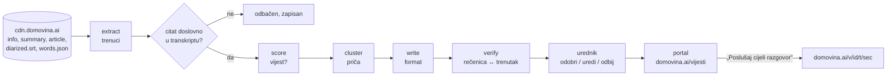

# Plan: portal vijesti iz podcasta (2026-11-05)

Ovo je plan za niz Claude Code sesija. Cilj je **samostalna aplikacija** u `vijesti/`
koja iz već obrađenih epizoda (CDN `cdn.domovina.ai`) piše novinarske članke i objavljuje
ih na `domovina.ai/vijesti`. Svaka sesija je jedan paket. Završava se zelenim
`npm run check` (u `vijesti/`), commitom i `/wrap-up` handoffom koji je sadržaj handoffa
sljedeće sesije.

Lanac i pravila su u [handoffs/README.md](handoffs/README.md), radna lista u
[../TODO.md](../TODO.md), odluke u [decisions.md](decisions.md).

Uzor: `~/git/pinkainc/open-banking` i `~/git/pinkainc/open-ledger` (isti oblik plana,
TODO-a i lanca handoffa).

## Zašto ovo postoji

Pretraga 5.11.2026. nije našla portal, ni u regiji ni u svijetu, koji javno objavljuje
članke napisane iz tema s tuđih podcasta, sa sekundom uz svaki citat i kroz više emisija.
Najbliži su Particle (isječci podcasta uz vijesti) i interni alati redakcija za praćenje
podcasta, čiji izlaz vide samo novinari. DOMOVINA.ai već ima transkript s vremenom svake
riječi, govornike, osobe i članak po sekcijama, pa nedostaje sloj iznad epizode.

## Arhitektura

### Tri sloja iznad epizode

| Sloj | Što je | Nastaje u |
|---|---|---|
| **Trenutak** (`moment`) | izjava: raspon vremena, govornik, doslovni citat, tema, entiteti, ocjena vijesti | `engine/extract` nad `diarized.srt` + `words.json` |
| **Priča** (`story`) | skup trenutaka o istoj temi iz više epizoda i kroz vrijeme | `engine/cluster` (embedding + entiteti) |
| **Članak** (`article`) | priča × format × jezik, verzioniran, s popisom trenutaka na koje se poziva | `engine/write` → `engine/verify` → urednik |

Stil (neutralni, analitički, kratki) NIJE nova stranica nego prikaz iste kanonske
stranice. Jedna priča ima jednu kanonsku stranicu po formatu koji donosi nešto bitno
drukčije. Razlog je Googleova politika protiv masovnog sadržaja („scaled content abuse”),
koja ruši domene s puno sličnih AI tekstova.

### Tok

### Sastav aplikacije (`vijesti/`)

- `engine/`: TypeScript (Node 22). Čita CDN samo čitanjem, nikad ne piše na CDN ni u
  pipeline. Koraci su CLI naredbe (`vijesti extract|score|cluster|write|verify <id>`) i
  dnevni job.
- `db/`: Postgres shema `vijesti` (moments, stories, articles, article_versions,
  article_sources, corrections, runs). Testovi idu na PGlite (bez Dockera). Produkcija je
  shema u postojećoj bazi `api.domovina.ai`, uz korisnikovo odobrenje (S7).
- `portal/`: Astro sa server-side renderom na Cloudflare Workers. Javne stranice, admin
  urednika iza Supabase prijave (uloga `editor`), news sitemap, RSS, `NewsArticle` JSON-LD.
- `LlmClient` sučelje: pravi klijent (zadano Gemini, kao pipeline, ključ u
  `vijesti/.env`) i lažni klijent za testove. **Testovi nikad ne zovu mrežu.**

### Zašto ne Flutter za portal

Portal živi od Googlea (Search, News, Discover), koji traži pravi HTML u prvom odgovoru,
brz LCP i strukturirane podatke. Flutter web daje praznu stranicu i sporo pokretanje
(`docs/2026-10-09-boot-splash.md`). Aplikacija ostaje Flutter, a portal je ulaz u nju.

### Zašto `domovina.ai/vijesti`, a ne poddomena

Subpath nasljeđuje autoritet domene. Postojeći `web/_worker.js` prosljeđuje `/vijesti/*`
portalu preko service bindinga (S7). Ruta mora ući u oba matchera workera i u
`scripts/test-social-tags.mjs`, kao svaka nova ruta.

## Tri tvrda uvjeta

1. **Citat je doslovan ili ga nema.** Mehanička provjera prema `words.json` (ili SRT-u uz
   nižu sigurnost) prije svega ostalog. Pogrešan citat na portalu je kleveta, ne bug.
2. **Urednik u petlji.** Zakon o medijima (elektronička publikacija: upis kod AEM-a,
   impresum, glavni urednik). EU AI Act čl. 50(4): AI tekst o temama od javnog interesa
   mora biti označen, osim ako prođe ljudski urednički pregled uz uredničku odgovornost.
3. **Pristanak kreatora.** Citiranje je dopušteno, sustavno prepisivanje tuđe epizode
   nije. Portal objavljuje samo s kanala na popisu dopuštenih (`allowlist`), a popis puni
   korisnik. Veza s preuzimanjem kanala i dijeljenjem prihoda je S13.

## Plan po sesijama

| # | Faza | Paket | Odluke | Gotovo kad |
|---|---|---|---|---|
| **S1** | F0 | Kostur `vijesti/`: npm paket, `npm run check` (tsc, eslint, vitest), CDN loader s tipovima, fixturei 5 stvarnih epizoda, shema baze + migracije na PGlite, `LlmClient` + lažni klijent | 100– | check zelen; loader čita svih 5 fixturea; migracije idu gore i dolje |
| **S2** | F0 | Izvlačenje trenutaka + provjera citata (normalizacija, tolerancija, SRT fallback), `vijesti extract <id>` | 200– | provjera hvata sve namjerno pokvarene citate u fixtureima; nijedan izmišljen citat ne prolazi |
| **S3** | F0 | Ocjena vijesti + **mjerenje** na stvarnom uzorku: trenutaka po epizodi, % odbijenih citata, % vijesti, trošak po epizodi. Izvještaj u `vijesti/docs/research/` | 300– | izvještaj s naredbom koja reproducira svaku brojku. **Vrata: korisnik kaže da/ne** |
| **S4** | F1 | Format „vijest iz podcasta” + verify (rečenica ↔ trenutak), stilski vodič HR, verzije članka | 400– | verify hvata ubačene halucinacije u fixtureima; 10 članaka iz S3 uzorka u nacrtu |
| **S5** | F1 | Urednički tok: stanja (nacrt → pregled → odobreno → objavljeno → ispravljeno), dnevnik ispravaka, API | 500– | cijeli tok pokriven testovima; ispravak objavljenog članka ostavlja trag |
| **S6** | F1 | Portal: naslovnica, članak, audio isječak uz citat (`audio.mp3#t=`), link u aplikaciju, admin urednika (članak lijevo, trenuci s playerom desno) | 600– | Playwright e2e zelen; Lighthouse mobile ≥ 90 za članak |
| **S7** | F1 | Distribucija i pravni sloj: news sitemap, RSS, canonical, robots, `/vijesti/*` kroz `_worker.js`, impresum, stranica o AI i ispravcima, produkcijska shema, Preview deploy | 700– | Preview radi s pravim podacima. **Vrata: korisnik odobrava produkciju i upis kod AEM-a** |
| **S8** | F1 | Dnevni job (launchd): nove epizode → nacrti u red, Telegram kroz `scripts/telegram-notify.rb`, idempotentno | 800– | dva uzastopna pokretanja ne rade duplikate. **Vrata: 30 objavljenih članaka, nula ispravaka citata** |
| **S9** | F2 | Priče kroz više podcasta: embedding, grupiranje, stranica priče, format „pregled” | 900– | test s istom temom iz 3 epizode daje jednu priču |
| **S10** | F2 | Stranice tema i osoba (veza na `/p/` preko `domovina-rag`), Meili indeks `articles`, push novog članka kroz FCM teme | 1000– | osoba s člankom ima vezu u oba smjera |
| **S11** | F3 | Formati: intervju u obliku pitanja i odgovora, citati tjedna, objašnjenje; stilovi kao prikaz; zaštita od duplikata (prag sličnosti, najviše N po priči) | 1100– | generator odbija članak preblizak postojećem |
| **S12** | F3 | EN izdanje odobrenih članaka (hreflang), newsletter | 1200– | EN stranica ima canonical + hreflang par |
| **S13** | F3 | Brzina: okidač iz pipelinea umjesto pollinga (cilj < 2 h od objave podcasta), pristanak kreatora i veza s vlasništvom kanala | 1300– | izmjereno vrijeme od objave do nacrta |

Procjena: 13 sesija. S3, S7 i S8 završavaju **ljudskim vratima**: lanac staje dok
korisnik ne odluči. S9 i S10 su neovisni i mogu ići paralelno u worktreejima.

Najrizičniji su S2 (provjera citata: Gemini tekst u SRT-u i Speechmatics riječi se ne
poklapaju uvijek, vidi `docs/2026-10-06-titlovi-rijec-po-rijec.md`) i S3 (može ispasti da
je udio vijesti premali za portal). Zato S3 mjeri prije nego išta ide javno.

## Gdje smo

S0 (2026-11-05): plan, TODO, handoffi.
S1 (2026-11-05): kostur, CDN loader, 5 fixturea, shema, `LlmClient` — `4b9f74d`, 86 testova.
S2 (2026-11-05): trenuci, provjera citata, `vijesti extract` — `336426f`, 167 testova.
S3 (2026-11-06, djelomično): ocjena vijesti, Vertex backend — `661ddc6`, 214 testova; mjerenje kroz `agy` odgođeno (odluka 315), vrata pomaknuta prije S7.
Sljedeće: S4 (prvi dio: `agy` backend + `npm run eval`, bez pravih poziva).
